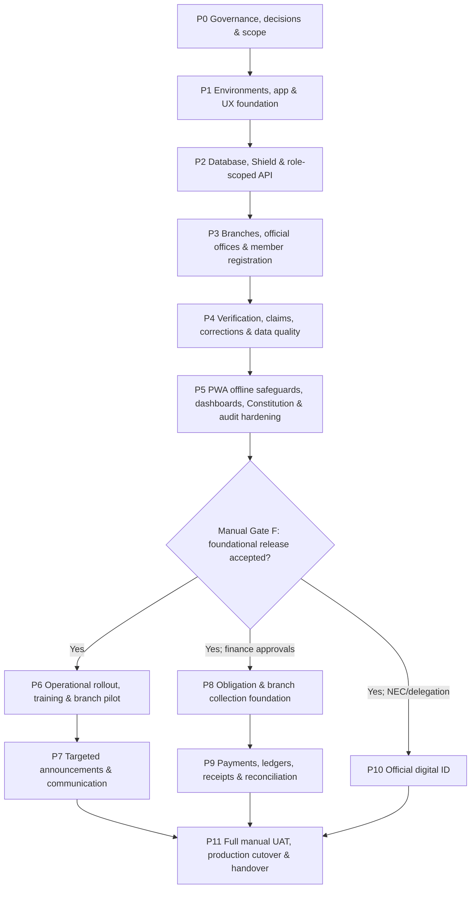

# IEDPU NORTH ZONE DIGITAL MEMBERSHIP, ADMINISTRATION AND DEVELOPMENT PORTAL
# STRATEGIC PHASE IMPLEMENTATION PLAN AND MANUAL VERIFICATION PLAYBOOK

**Document ID:** IEDPU-NZ-IMP-001  
**Version:** 1.0 — development planning draft  
**Prepared:** 19 November 2026  
**Project authority:** IEDPU North Zone Initiative Committee, within formally delegated IEDPU authority  
**Initial scope:** Existing IEDPU members in the approved North Zone initiative; 19 Northern States and FCT  
**Companion documents:** Technical Blueprint/SRS `IEDPU-NZ-TECH-SRS-001`; Database Schema Design `IEDPU-NZ-DBS-001`  
**Verification policy:** **Manual verification only. No PHPUnit, automated browser suites, automated API suites, automated regression suites, or test-driven development mandate.**

---

## 0. Document purpose, precedence and how to use it

This is a **sequenced delivery plan**, not a replacement SRS or a redesign of the approved database. It maps the functions, constraints and schema entities in the foundation documents into practical phases with dependencies, deliverables, human verification activities, evidence and decision gates.

### 0.1 Documents governing every implementation decision

| Code | Foundation document | Authority for implementation |
|---|---|---|
| **C** | **Constitution of the Ilorin Emirate Descendants Progressive Union (IEDPU), 2015** | Constitutional organs, branches, membership and official ID-card authority; financial and governance provisions. |
| **P** | **Refined IEDPU North Zone Population Registration and Development Initiative** | Initial organisational purpose, geography, information to collect, data quality, privacy, mobilisation and reporting. |
| **S** | **IEDPU North Zone Technical Blueprint and SRS v1.0** | Later approved member-only first-release scope, modular architecture, user experience, business functions, authorisation, PWA restrictions and acceptance criteria. |
| **D** | **Database_schema_Design.md — IEDPU-NZ-DBS-001** | Entity boundaries, individual tables/fields, keys, history, financial ledgers, constraints, migration dependencies and seed responsibilities. |
| **U** | **Explicit user instruction for this plan** | Perform every verification **manually**; do not require PHPUnit or any other automatic testing framework. |

**Precedence for this work:** Respect constitutional limits; follow subsequent explicit project decisions over the broader aspirations of the initial proposal for the first release; follow SRS functions and database design unless a discrepancy is raised for decision. The later user instruction **U** replaces testing-method suggestions in S §16 and §18.2 with manual execution. It does **not** remove any functional, security, performance, accessibility, financial, integrity or audit acceptance requirement.

### 0.4 P0 disposition following project-owner implementation clarification

The project owner confirms the development engagement is already approved and partially funded. **P1 commencement is not conditional on obtaining the same approval again.** P0 reconciles technical decisions and activation holds, not procurement or contract authorisation.

Authorised Committee administrators enter and manage **zones, branches, Branch Chairmen/office holders and portal role profiles** through protected interfaces. No zone, branch, office-holder or role name/ID is a hardcoded business rule. Northern Zone remains the approved operational scope and executable permission keys remain release-controlled. The historical branch schedule is optional reference material, not mandatory seed data.

Missing branch/Chairman lists, finance providers or NEC card delegation do **not** block P1. P1 starts with safe empty organisational datasets and server-disabled live capabilities. Live registration requires validated active branches, versioned registration form and privacy approval; finance and official ID retain separate gates.

**Owner-confirmed answers:** First Committee Super Administrator identity is supplied at P2 secure provisioning. The **Committee Super Administrator directly activates branches** after validation and audit, without a mandatory second approver. The **Committee Super Administrator approves versioned registration forms and privacy notices** before live use, subject to lawful processing. A separate developer interface retains specialist technical duties; developers are IEDPU members and may also receive independently authorised organisational roles. See `docs/implementation/P0/Engineering_Decision_Register.md`.

### 0.2 Hard scope boundaries

- **Existing IEDPU members only**, not a public register of all descendants in the first release.
- **Individual registration**, not a household census.
- **Northern Zone** project operations; state/FCT and LGA are **geographical descriptors**, not additional organisational command tiers.
- Each registrant is connected with an **approved branch**; branch verification is the primary route.
- The **Initiative Committee** is the highest **project operational administrator** only to the extent formally delegated; it is not a new constitutional organ.
- **Official offices** are separate from **portal roles**.
- The Constitution assigns official membership ID-card issuance to the **NEC**; do not activate an issuance workflow without the appropriate authorisation/delegation.
- Member financial standing is not identical to registration/verification status.
- Approved role permissions come from a predefined catalogue; developers do not gain Committee authority merely because they operate the system.
- Only low-risk profile changes can be cached and synced offline; **new member registration and all sensitive decisions remain online-only** initially.

### 0.3 Practical release strategy

**Release F — Foundational Membership Release**: public site and readable Constitution, login, branch directory, roles and separate official offices, member registration, verification, member account claiming, audit, basic reporting, mobile UX, installed PWA and permitted offline behaviour. This is the **first end-to-end release** under S §17.

**Release O — Operational Administration Release**: complete role/officer/transfer workflows, quality controls, approved data governance, higher-volume branch operations, targeted announcements and associated dashboards.

**Release FIN — Finance Release (separately gated)**: configurable obligations, branch dues automation, receiving accounts, provider/manual payment verification, financial ledgers, reconciliation, receipts and statements.

**Release ID — Official Digital Membership ID (separately gated)**: card issuance, replacement and QR checks, only after confirmation of NEC/delegated authority.

These are **delivery groupings**, not changes to the initiative's broader five-phase community-development strategy. Future non-member census and economic-development programme software remain outside the initial implementation unless later approved.

---

# 1. Implementation method and human decision gates

## 1.1 Delivery rules

1. **Vertical slices first.** Each phase must produce a usable flow from mobile/desktop screen → API → server permission/business rule → database → audit → human-observable result.
2. **Dependencies first.** Never build an approved decision screen before user identity, roles, branch scope, workflow validation and audit infrastructure exist.
3. **One authoritative server.** Vue/PWA is a user interface; CodeIgniter is the authority for validation, access, verification and financial status; MySQL preserves data/history.
4. **Incremental database migrations.** Build migrations in dependency order; do not hand-edit live database schema. Do not fabricate Shield internals.
5. **Explicit feature activation.** Hide *and server-disable* any unapproved functions; hiding a menu is not security.
6. **Mobile is a full experience.** On a phone a user must be able to perform every authorised function that the desktop can, without technical knowledge or confusing navigation.
7. **No software-assisted execution of test cases.** A human carries out each check and observes the results. Browser developer tools, database inspection, manually issued HTTP requests, and manually reviewed logs may be used as **observation instruments**, not scheduled/executed test suites.
8. **Normal operational automation is not testing.** Payment-provider callbacks, scheduled recurrence, approved backups, automatic session expiry and offline syncing remain legitimate product/operations functions because the SRS requires or permits them. They are verified manually.
9. **Gate before merge/release.** No feature is considered done until its human checklist is passed, evidence recorded and reviewer signs off.

## 1.2 Roles and sign-off responsibilities

| Role | Responsibilities | May approve |
|---|---|---|
| Initiative Committee / authorised project owner | Clarifies policy, approves phase scope, branch data, role matrix, releases, high-risk actions and production ownership | Business and production gates within delegation |
| Constitutional authority / NEC or authorised delegate | Confirms constitutional authority and official ID issuance where applicable | Constitutional/ID-specific gate |
| Project coordinator | Holds requirements log, dependency register, decisions, defect log, acceptance packs | Completeness of evidence, not constitutional policy |
| Backend/database developer | CodeIgniter modules, Shield integration, migrations, business rules, API, audit, payment ledger | Technical delivery evidence (not self-approve high-risk business action) |
| Frontend/PWA developer | Vue 3 no-build interface, mobile layouts, accessibility, caching and Dexie | UI delivery evidence |
| Designated manual verifier | Executes checklists; screenshots and records observable outcomes | Pass/fail findings |
| Branch Chairman/authorised Branch Executive | Confirms branch workflows, genuineness review and branch-scoped usability | Branch UAT |
| Enumerator | Confirms field-registration UX and access boundaries | Enumerator UAT findings |
| Selected verified member | Confirms claim, profile, privacy and mobile usability | Member UAT findings |
| Finance/technical administrator, where authorised | Verifies financial and infrastructure steps using permitted accounts | Finance/operations UAT |

One person can fulfil multiple development roles in a small team, **but a high-risk approver must be independent where maker-checker applies**, and the business owner should not treat developer self-certification as final UAT.

## 1.3 Phase gate definitions

- **Entry gate:** prerequisites, decisions, approved test accounts, reference data and working environment exist.
- **Build complete:** agreed interfaces and services exist in the phase environment; migrations are versioned; critical actions produce audit records.
- **Manual verification gate:** every **critical (C)** test passes; all **high (H)** tests pass or an authorised documented exception is granted if non-security-critical; no unresolved privacy, privilege, financial-integrity or data-loss defect.
- **UAT gate:** authorised representative uses real workflow examples with test data and signs the acceptance sheet.
- **Release gate:** backup/rollback, access review, security, mobile check, and required approvals complete.

**Block release automatically?** No automatic quality-gate software is required. The release is **administratively blocked** by human reviewers until evidence and signatures are present.

---

# 2. Sequencing and high-level dependency map



**P8–P10 are separate, approval-dependent tracks.** There is no requirement to block foundational member registration while waiting for a payment provider or official ID issuance authority. If an approval is not obtained, deliver the approved parts and keep the dependent feature inactive.

## 2.1 Phase summary

| Phase | Objective | Depends on | Gate / output |
|---|---|---|---|
| **P0** | Confirm governance and implementation decisions | Source documents | Signed scope/authority and decision register |
| **P1** | Establish environments and mobile-first application shell | P0 | Working CI4/Vue/Bootstrap/PWA shell under HTTPS |
| **P2** | Build schema, Shield identity, scoped roles, audit | P1 | Human-verified login, migrations and access isolation |
| **P3** | Branches, offices, approved forms, self/assisted registration | P2 | Existing-member submission appears in correct branch queue |
| **P4** | Branch verification, claims, member history, corrections | P3 | Verified member can securely claim and access own record |
| **P5** | Constitution, reports, mobile completion, offline sync, audit gates | P4 | **Release F** signed UAT |
| **P6** | Controlled branch pilot, training, migration and quality improvement | P5 | Pilot sign-off, coverage/data-quality review |
| **P7** | Groups, targeted official announcements, recipient snapshots | P2–P6 | **Release O** communication gate |
| **P8** | Obligation lifecycle, branch due requests and approved accounts | P2–P6; financial authority | Finance configuration gate |
| **P9** | Confirmed payments, statements, refunds, reconciliation | P8; approved provider and controls | **Release FIN** gate |
| **P10** | NEC-authorised digital IDs and QR verification | P4–P5; explicit constitutional authority | **Release ID** gate |
| **P11** | Manual release acceptance, deployment, handover | Applicable approved tracks | Production acceptance per activated scope |

**Scheduling:** This is a dependency-based plan, not a fabricated calendar. The source documents do not specify the final team capacity, funding, provider procurement dates or approval turnaround. Do not invent firm phase durations; the project coordinator should date each phase only after P0 staffing and the dependency review.

---

# 3. Phase-by-phase execution plan

## P0 — Engineering baseline, unresolved decisions and release controls

**Purpose.** Confirm that commencement is already authorised; reconcile technical ambiguities and establish safe implementation rules. P0 is a developer-led documentation exercise, not a second contract or funding approval. Do not introduce real member data in P0.

**Inputs:** Constitution §§2, 4, 6, 13 and First Schedule; Business Blueprint §§2–11; SRS §§1, 6, 18; Database Schema §§1, 30; current project-owner clarifications.

**Work packages**

1. Confirm first-release boundaries: existing members only, individual registration, Northern Zone operations, no state/LGA command hierarchy.
2. Adopt administrator-managed zone, branch, office-holder and role-profile records. Historical branch names are optional references; no mandatory organisational seed. Committee Super Administrator may activate validated branches directly with audit.
3. Define controlled executable permission keys, dynamic role bundles, scoped assignments, protected grants and one-time audited initial provisioning. First operational Super Administrator identity arrives at P2, not P0.
4. Document Chairman/office-holder entry before member registration, later reviewed member linking and separately authorised verification access. Distinguish Committee business powers from developer technical interface; developers may hold separately authorised organisational roles.
5. Prepare versioned registration-field and privacy-notice decision templates; leave live registration disabled until Committee Super Administrator approval and legal privacy prerequisites.
6. Record safe defaults for official membership numbers, NEC cards, offline private data, exports, payments, external messaging and backup/retention ownership.
7. Confirm IEDPU ownership of domain, hosting, repository and data; check actual technical environment during P1, without guessing capabilities.
8. Maintain engineering decisions and unresolved business/constitutional *activation* holds with owners and affected phases; do not block P1 on future-provider procurement.
9. Confirm release boundaries and human-executed manual verification policy.
10. Publish a P0-to-P1 readiness record with adopted decisions, outstanding activation holds and server-disabled live functions.

**Deliverables:** `Engineering_Decision_Register.md` (engineering reconciliation), `Project_Decision_Register.md`, `Governance_Authority_Matrix.md`, `Registration_Field_Rules.md`, `Role_Permission_Approval_Matrix.md`, `Data_Governance_Approval_Record.md`, `Manual_Test_Register.md`, P0 decision sheet and **optional** `Approved_Branch_Baseline.csv` template/import. External approvals not received must remain marked pending.

**Manual checks:** Cross-read four foundation documents for conflicting seed assumptions; verify no hardcoded organisational names/role profiles; distinguish office and portal roles; walk through existing-member/non-member registration; confirm all activation holds.

**Exit:** Engineering baseline ready for P1 with no unresolved *technical design* blocker. Constitutional, privacy, finance and official ID approvals are enforced at their respective activation gates.

## P1 — Technical environment, delivery skeleton and mobile-first UX

**Purpose.** Produce a functioning deployable modular monolith foundation, not isolated designs.

**Inputs:** S §§2–5, 11, 14–15, 18.2, 19; D §§2, 24, 28; P §10.

**Work packages**

1. Prepare isolated **local XAMPP**, **staging** and **production** configuration profiles. Record PHP and MySQL/MariaDB version compatibility, required extensions, database privileges and composer lockfile.
   **P1-WP01 approved runtime clarification (21 November 2026):** Existing local XAMPP PHP 8.2.4 is accepted for development. CodeIgniter 4.7.6 and Shield 1.4.1 both declare PHP ^8.2; the project minimum is ^8.2.4. Regenerate the lockfile using Composer update on the actual development machine. This exception does not authorise an outdated PHP 8.2.4 patch for public staging/production; deployment must use a currently supported, security-patched PHP runtime and pass platform checks.
2. Install latest approved stable CodeIgniter 4 and exact locked Shield version; identify actual `users.id` schema type before custom FKs.
3. Implement modular-monolith structure, same-origin `/api/v1/` JSON API conventions and centralised server validation/error responses.
4. Set up **Vue 3 global production build** with Composition API, ordinary JS files and locally hosted vendors; **no Vite/Webpack/Node build, TypeScript, Pinia, Vue Router or `.vue` SFC requirement**.
5. Use browser History API for simple navigation with deep links, refresh and Back/Forward; use native Fetch and Bootstrap 5.3.9.
6. Implement design tokens based on S §4: Deep IEDPU Red `#B4232F`, Executive Navy `#17324D`, Professional Teal `#0F766E`, white/light neutral backgrounds and accessible focus/status styles.
7. Build public page shell, member shell, branch administrative shell, Committee shell and **separate technical administration entry**; visible menus depend on role but server validates every protected action.
8. Build shared UI patterns: clear title/location, next action, confirmation, loading, empty/error states, short forms, plain language, phone-friendly lists/cards and adequate touch targets.
9. Add web manifest, Service Worker shell caching strategy, offline fallback screen and Dexie/IndexedDB plumbing; **do not yet enable sensitive offline user data**.
10. Evaluate shared hosting for HTTPS, PHP, extensions, InnoDB, cron, document-root control, private storage and callback reachability. If it cannot satisfy the SRS, **change hosting before live data**.

**Deliverables:** deployable CI4 project, source-control baseline, locked dependencies, database connection, `/api/v1/` health/entry responses, local vendor assets, complete responsive shells, branded theme tokens, manifest, service worker, staging configuration and environment checklist.

**Manual checks:** Load public route on small Android and desktop; test menu, Back/Forward, deep-link refresh, HTTPS, offline shell after install; inspect browser network requests to ensure no external Vue/Bootstrap CDN is needed and no credentials appear in public assets; verify `app/`, `.env` and `vendor/` cannot be fetched from public URLs.

**Exit:** Stakeholder can open a working mobile and desktop shell; deployment method is approved; no live personal information introduced.

## P2 — Database foundation, authentication, scoped access and audit

**Purpose.** Establish the security/data model on which every other module depends.

**Inputs:** S §§6, 8, 11–13; D §§2, 4–6, 8–9, 21–24, 26.

**Work packages**

1. Run **Shield's own migrations** (do not clone/reinvent Shield user/auth tables); manually inspect their structure and matching user-ID types.
2. Implement D-defined organisation/geography tables and protected admin workflows for zone, approved coverage, branch and office records; permit reviewed optional reference imports, but do not mandatory-seed zone/branch/role records or auto-activate branches.
3. Implement portal roles, permission catalogue, role-permission mappings and scoped assignment tables, including date/scope validity and protected-role approval controls.
4. Implement independent official-office catalogue and assignments. Do **not** give portal permissions because of constitutional titles.
5. Implement reusable approval requests/decisions with maker-checker where required and record both decision and business operation.
6. Implement central audit and security-event service (actor, action, permission, scope, affected record, outcome, masked before/after, correlation ID, time); use append-only semantics and protected audit reads.
7. Implement Shield sign-in/out, invitation/activation, password change/reset, session expiry/revocation, failed login throttling, administrator suspension and MFA on privileged accounts as approved.
8. Enforce `global`/`zone`/`branch` role scope server-side per API action and query. Role revocation/expiry must take effect on subsequent protected requests.
9. Establish member-to-user link and claim data structures without allowing a claim to bypass later verification.
10. Implement encrypted private-file storage metadata, privacy notice versioning and approved upload policy foundations.
11. Apply and manually inspect migration dependencies and constraints in D. Any circular FK (e.g. approval request referencing a business entity that itself links an approval; file metadata and members) must be resolved with **staged migrations**, not disabled integrity rules.
12. Establish development/staging database backup and restoration procedure, plus separate protected audit checkpoints for later release.

**Deliverables:** installed Shield tables, versioned CI4 migrations/seeders, role-scope service, initial roles/permissions, official-office data model, approvals/audit services, privilege-separated DB credentials, user-invitation process, role-isolation manual-test record, backup and restore record.

**Manual checks:** Attempt cross-branch API access even when UI hides a menu; attempt self-elevation and expired-role access; compare Shield PK/FK types; manually inspect table constraints and seed data; inspect audit event for both success and denial; confirm technical admin cannot silently approve business functions.

**Exit:** Authentication and backend scope checks pass; migrations work on supported local/staging database; audit and protected roles are operational. **No member-facing registration enabled yet.**

## P3 — Branch directory, offices, registration and enumerator workflow

**Purpose.** Deliver correct, individually attributable **existing-member** registration.

**Inputs:** S §§7.1–7.2, 7.5–7.6; D §§4, 6–8, 10, 25; C §6 and First Schedule; P §§6–9.

**Work packages**

1. Provide admin entry and controlled confirmation/activation of branch records with current state/FCT and locality; preserve First Schedule source spellings only when an optional reference import is used.
2. Provide Committee branch CRUD/activation/deactivation (within authority), branch lookup and branch-only scope enforcement; inactive/unconfirmed branches cannot receive new registrations.
3. Provide official IEDPU office records and term history as **information**, with separate software-role assignments.
4. Build approved versioned registration form (`registration_form_versions`, `registration_field_rules`), field-level server validations, privacy notice acknowledgement and optional professional-data consent.
5. Capture individual name, gender, age/DOB where approved, contact, ancestry, residence, existing IEDPU relationship and selected branch. Optional professional information must not block registration.
6. Deliver self-registration **online**, and authorised enumerator/branch-assisted registration **online**; record who submitted, channel, branch and snapshot.
7. Generate collision-safe registration reference using approved sequence policy; do not prematurely claim NEC-issued official membership number where unresolved.
8. Flag possible duplicate contacts/names/other approved similarity signals for review; do not reject shared family phone numbers automatically or delete suspected duplicates.
9. Capture pending/submitted status and route to correct branch verification queue; registration alone does not equal verified membership.
10. Deliver simple submission receipt/reference and plain-language next-step explanation, on mobile as well as desktop.

**Deliverables:** approved branches, enumerator allocation, versioned registration form, self/assisted API and UI, reference generation, duplicate flagging, member/registration data, privacy capture, submitted queue, branch and source trail, manual registration acceptance record.

**Manual checks:** Branch selector contains only active approved branches; enumerator cannot submit for unassigned branch; submitted records appear in correct queue; identical form submission does not silently create parallel canonical identities; phone-size registration works without horizontal scrolling; registration is unavailable when offline; required-field/consent rules match approved form.

**Exit:** Correct branch receives valid existing-member submissions; every material action has an audit trail. Do not claim verification or official ID at submission.

## P4 — Branch verification, member claims, corrections and history

**Purpose.** Complete the founding member lifecycle from submitted registration to securely linked verified account.

**Inputs:** S §§6.3–6.7, 7.3–7.4; D §§5–7, 21, 26; C §4.

**Work packages**

1. Build branch queue with clear pending/review/escalation filters and full mobile equivalence.
2. Implement preliminary Branch Executive review, final Branch Chairman/delegated verification, requests for correction, disputes, rejection and Committee escalation; each records reviewer, decision, reason and timestamp.
3. Prevent unauthorised review, cross-branch decisions and enumerator self-approval; confirm verification remains online-only.
4. Maintain immutable review history; status reversal from verified to unverified cannot occur silently.
5. Implement verified-member account claim securely; one member ↔ at most one **active** login link; preserve revoked link history; prevent someone claiming another person's member record.
6. Build member dashboard and editable/non-editable field distinctions. Name, date of birth, account recovery contact, branch, official office and financial data follow protected approval paths.
7. Implement profile revision history, correction requests, duplicate-case resolution and member data-quality issue tracking.
8. Implement current and historical branch assignments and controlled branch transfer preserving existing member number and finance history; maintain `members.current_branch_id` consistently.
9. Implement membership-status events separately from verification and financial standing; no automatic suspension because of unpaid dues.
10. Add branch baseline submissions and clearly labelled registration, verified, pending, duplicate, coverage and completeness summaries.

**Deliverables:** verification workflow, secure claims, member dashboard, correction/duplicate modules, transfer history, status events, accurate branch statistics and signed branch/member UAT pack.

**Manual checks:** Chairman approves own branch member but not another branch; preliminary review does not automatically finalise; rejected case retains history; verified account claims original record without duplicate; protected field edit creates request; transfer preserves all historic references; test member cannot access another member's statement/profile.

**Exit:** S §17 steps 1–13 work end-to-end, pending P5 mobile/offline/reporting checks.

## P5 — Public Constitution, PWA, dashboards, security hardening and Release F

**Purpose.** Complete all S §17 foundational acceptance criteria on mobile and desktop.

**Inputs:** S §§3–5, 7.14–7.16, 8, 13–17; D §§8–10, 17–19, 27–29.

**Work packages**

1. Publish **the exact authorised Constitution wording** as segmented accessible webpages with table of contents, Previous/Next, version/effective information and original PDF support. Do not rewrite text as if it were official; separate explanatory copy.
2. Complete role-specific dashboards for Committee, branch, enumerator and member using **authoritative server records**, with scope checks.
3. Implement S-approved public caching: app shell, public Constitution and designated assets; **never indiscriminately cache authenticated APIs**.
4. Build explicit **opt-in trusted-device** local profile cache with last-sync stamp, retention and clear-data controls; label offline record as possibly stale.
5. Allow only formally approved low-risk profile field changes in Dexie offline queue; use client mutation ID, base record version, sync receipt, idempotency and 409 conflict resolution; 401 pauses and requests sign-in.
6. Keep new member registration, verification, transfers, privileges, bank accounts, finance, payments, card issuing and publishing online-only.
7. Test manual touch usability on small Android, larger phone, iPhone, tablet and desktop as available; check keyboard focus, screen-reader labels, contrast and low-bandwidth behaviour.
8. Validate audit completeness, secret masking, restricted exports, private file storage, session security, backups and restoration.
9. Execute the **foundational manual verification packs** in §6; fix failures; rerun affected cases plus manual cross-module regression.
10. Conduct S §17's exact 16-step practical workflow with Committee, branch, enumerator and member representatives; obtain signatures.

**Deliverables:** readable Constitution, dashboards, safe installed PWA, permitted offline sync, responsive UX, manual accessibility/security/restore evidence, signed **Release F** acceptance, pilot-ready release notes.

**Manual checks:** All S §17 points, manual packs F1–F6 and M01–M68 as applicable. Verify 401/409 with deliberately constructed manual steps, repeated sync, stale card indicator and loss-of-network scenarios.

**Exit:** **Release F acceptance is signed.** No payment or official-card capability may be claimed as activated simply because database tables or preliminary screens exist.

## P6 — Controlled branch pilot, training and verified data improvement

**Purpose.** Introduce the accepted foundational release gradually, strengthen the register and confirm staff can actually use it.

**Inputs:** P §§6–13; S §§3, 7, 16–17; D §§7, 10, 27.

**Work packages**

1. Select a Committee-approved small set of representative branches and authorised personnel; record pilot eligibility, roles and geographic scope.
2. Conduct mobile-first orientation using real tasks: sign-in, finding assigned branch, registering an existing member, resolving an error, verification and viewing reports.
3. Use **synthetic/sample data** for practice, never expose real member data in training videos or screenshots without approved protection.
4. Register pilot records under approved policy; monitor duplication, completion, verification turnaround, branch attribution and members' ability to access their own accounts.
5. Review branch baseline estimates and completeness rates with branch representatives; correct source issues through documented workflows.
6. Record help requests, accessibility failures, confusing text and network constraints; fix and manually recheck.
7. Expand to more branches only after pilot acceptance, backup verification and Committee approval.

**Deliverables:** pilot register, attendance/training notes, individual role UAT forms, data-quality assessment, corrected workflows, revised user instructions and signed rollout decision.

**Manual checks:** Have a new enumerator complete registration using only task guidance; have a Branch Chairman independently verify; manually compare branch counts with approved baseline; confirm reported inaccuracies and fixes are traceable; test mobile and intermittent network conditions.

**Exit:** Committee approves controlled expansion and the operating support arrangement.

## P7 — Targeted announcements and communication (Release O track)

**Purpose.** Deliver consent-appropriate official communication to accurately selected audiences.

**Inputs:** S §§7.12, 10; D §§15, 20; P §5 Phase 4 and §9.

**Work packages**

1. Build `member_groups`, membership maintenance, announcement draft/schedule/publish/archive, permissions and approval where required.
2. Target all eligible or verified members, individual, selected branches, selected groups, **official office** or **portal role** independently.
3. Display exact intended filters, exclusions and count **before** publish; require review/approval for sensitive wide-audience sends as policy requires.
4. At publication, persist `announcement_recipients` snapshot; do not dynamically rewrite old audience when a member changes branch/role.
5. Implement in-app read state; add email/SMS/push **only after provider and privacy/communication policy approval**; record delivery attempts without exposing contact values.
6. Keep offline publication disabled; public, approved content caching remains within S rules.

**Deliverables:** composer, targeting preview, recipient snapshots, delivery status views, audit events, opt-in/channel policy settings where approved, Release O communication acceptance.

**Manual checks:** Target Branch Financial Secretaries as **official office** and separately Financial Records Officers as **portal role**; verify differing recipient lists; publish and then change membership/roles—historical snapshot stays unchanged; verify no unauthorised bulk send.

**Exit:** Targeting, privacy and publication audit pass. External channels remain disabled if no approved provider/consent policy.

## P8 — Configurable dues, branch automation and collection account controls (finance prerequisite)

**Purpose.** Establish charge and approval records before money can be recorded.

**Inputs:** C §13; S §§7.8–7.9, 8–9; D §§11–12, 21, 26, 30.

**Entry gate:** Approved finance authority matrix; clear distinction between branch member dues and branch-as-organisation dues; bank-account verification method, settlement ownership and currency policy confirmed.

**Work packages**

1. Implement financial obligation categories without amounts hardcoded; one-time and recurring series with idempotent occurrence generation.
2. Implement obligation lifecycle `draft` → `submitted` → `approved` → `active` → `closed`/`cancelled`, plus reason, amount, deadline, creator and authority.
3. Target individual, branch members, selected branches, all eligible members or approved defined groups. Materialise `member_obligations`/`branch_obligations` and preserve term snapshots.
4. Implement authorised waivers, increases/decreases, extensions, cancellation and corrections as recorded adjustments, not editing settled history.
5. Build Branch Chairman/authorised Executive dues automation request with proposed title, amount, recurrence, deadline and receiving account.
6. Verify and approve bank account request separately; encrypt account number; approved collection-account record becomes selectable, pending request never does.
7. Create initial debit entries in relevant append-only ledger on publication; maintain status projections from ledger, not editable balances.
8. Apply Committee/project authority boundaries, maker-checker and comprehensive audit to sensitive actions.

**Deliverables:** obligation administration, assessment snapshots, branch dues request/approval, approved account registry, adjustment trail, ledgers' debit foundations, manual finance controls record.

**Manual checks:** Enter different amounts without code change; attempt unapproved obligation publication and unapproved bank account selection; change recurring series and confirm old assessments retain original terms; confirm both member and branch obligation cases.

**Exit:** Finance configuration/approval gate signed. **Do not accept payments until P9 is approved and passed.**

## P9 — Payments, immutable financial statements and reconciliation (Release FIN)

**Purpose.** Complete verifiable and accountable member/branch financial workflows.

**Inputs:** C §13; S §§7.10–7.11, 8–9; D §§13–14, 21, 26, 28–29.

**Entry gate:** Approved payment provider (or authorised manual-payment process), successful protected test transaction method, refund authorisation, reconciliation responsibility, evidence retention and bank/settlement decisions.

**Work packages**

1. Integrate selected provider using secure server-side verification and authenticated callback/webhook; do not store raw payment-card data.
2. Create payment initiation and state transitions; ensure browser redirects alone cannot set `successful`.
3. Record and deduplicate provider events; enforce idempotency keys and reference uniqueness; handle pending, unsuccessful, delayed and reversed responses.
4. Implement allocation across one or more assessments; amounts and currencies must reconcile; confirmed allocations post one corresponding ledger credit per source event.
5. Build chronological member/branch statements showing date, reference, narration, debit/credit, refunds, waivers, reversal, running balance and status. Statements must be printable/downloadable with access checks.
6. Issue official receipt references for confirmed transactions; retain void/replacement history.
7. Implement approved manual payment evidence, provider/bank reconciliation runs, mismatches and review outcomes.
8. Implement refund/reversal with approvals and traceable counter-entries; never delete original payments/ledger history.
9. Manually verify every financial failure mode, audit event and post-release reconciliation practice before activation.

**Deliverables:** provider boundary, confirmed payments, allocations, receipts, member and branch ledger/statements, reconciliation, refunds, finance audit pack, signed **Release FIN** decision.

**Manual checks:** Duplicate callback, incomplete browser flow, partial payment, mismatched amount, rejected settlement, over-allocation, refund/charge reversal and branch transfer. Compare ledger credits/debits to source transactions directly in a restricted database view.

**Exit:** Finance owner and Committee approve real-money activation. If provider remains undecided, retain P8 configuration but keep payments unavailable.

## P10 — Official digital membership ID and QR (conditional Release ID)

**Purpose.** Digitally display and verify membership identity without bypassing the Constitution.

**Inputs:** C §4; S §7.13; D §16 and membership-number decisions.

**Entry gate:** Written NEC/delegated ID authority; approved card branding/content, membership-number format, expiry/replacement policy and public QR disclosure fields.

**Work packages**

1. Implement sequence-safe stable membership number issuance; branch transfer must not change number.
2. Implement card issue records, unique card serial, random QR verification token hash, issuer body and authorisation reference.
3. Use approved card content and IEDPU identity; the public lookup reveals only approved minimal live status, not full contact/financial data.
4. Implement authorised replacement, suspension, revocation and expiry preserving older card records.
5. Permit explicitly marked **not live-verified** offline card copy only if approved; live verification remains online-only.
6. Audit all issue/change/verify operations appropriately.

**Deliverables:** authorised card creation, status history, QR endpoint, limited public verification, replacements, release documentation and signed constitutional/Committee gate.

**Manual checks:** Unauthorised user cannot issue; non-verified member cannot get active official ID; duplicate current active card prevented; old QR reflects revocation/replacement; no personal contact or financial balance exposed publicly; offline display clearly marked stale.

**Exit:** Authorised constitutional representative and Committee sign off. Without explicit authority, keep official issuance **disabled**, even if card layouts exist.

## P11 — Full manual UAT, production cutover and handover

**Purpose.** Validate only the approved/activated release tracks and transfer control to IEDPU.

**Inputs:** S §§14–17; D §§23–30; signed phase packs.

**Work packages**

1. Confirm activated scope: **F required**, O/FIN/ID only if their separate gates are signed.
2. Rerun high-risk manual cases in staging with appropriately authorised representatives; run full end-to-end role-based UAT on phone and desktop.
3. Review migrations applied, branch/source data, permission catalogue, site privacy text, backups, audit copy and restoration evidence.
4. Verify domain and hosting ownership, HTTPS redirect, correct document root, private files, cron/scheduled product tasks, email restrictions, payment webhook reachability (if activated) and least-privilege DB credentials.
5. Take and verify protected pre-cutover backup; apply reviewed migrations; seed approved records; check record counts manually; restore/revert if acceptance fails.
6. Confirm user training, branch support, incident route, operator accounts, role reviews, data requests and handover of credentials through a secure approved method.
7. Perform controlled go-live with Committee authorisation; monitor operational results and manually record any incident or failed workflow.
8. Sign final acceptance and publish release notes identifying activated modules, disabled gated features, known limitations and owners.

**Deliverables:** completed manual evidence ledger, signed UAT, go-live checklist, restoration record, deployed release, admin guide, branch/member quick guides, support/maintenance responsibility record and final handover certificate.

**Exit:** Production release accepted with no open critical/high integrity/privacy/security defects. Deferred modules remain server-disabled and labelled pending authority.

---

# 4. Critical dependencies and non-negotiable sequencing

| ID | Dependency | Why it matters | Blocks |
|---|---|---|---|
| DEP-01 | Committee mandate and delegation | Portal administrator ≠ constitutional authority | Production high-risk roles/actions |
| DEP-02 | Current approved branches entered/confirmed by admins | Registration/verification must route to legitimate active branch; no prerequisite to P1 coding | Live registrations |
| DEP-03 | PHP/DB/Shield version and matching FK types | Prevent incompatible migrations/user linkage | P2 onward |
| DEP-04 | Authentication, scopes and audit before business modules | Prevent privilege/data leakage | P3–P10 |
| DEP-05 | Approved registration form and privacy framework | Required/optional fields and lawful collection | Live registration |
| DEP-06 | Branch verification before normal member claiming | Prevent self-claim bypass | Member accounts |
| DEP-07 | Member history/ledger separation | Transfer must preserve records | Transfers and finance |
| DEP-08 | Foundation PWA policies and field allowlist | Avoid offline sensitive actions | Offline profile syncing |
| DEP-09 | Finance authority, obligations and bank approval | Prevent unauthorised charges/destinations | P8/P9 activation |
| DEP-10 | Provider verification and ledger controls | Prevent false paid status, duplicate credits | Real-money payments |
| DEP-11 | Consent/communication policy and provider | Prevent unauthorised external messaging | Email/SMS/push activation |
| DEP-12 | NEC/delegated issuer authority | Constitution governs membership-card issuance | P10 official card activation |
| DEP-13 | Backup restoration and independent audit protection | Recoverability and accountability | Production cutover |
| DEP-14 | Manual UAT sign-off | Latest user testing policy | Every release |

**Architectural dependency note:** D's displayed migration order is **guidance**, not a substitute for checking actual foreign keys. For example, `obligation_target_rules` references `member_groups`, so groups must exist before that FK is added. `official_office_assignments` references `members`. Some approval, member, asset and document references are cyclic or optional: create parent tables first without circular references and add verified FKs in later migrations. Do not disable referential integrity to make a migration appear successful.

---

# 5. Manual verification policy, record format and execution protocol

## 5.1 What is and is not permitted as testing

**Permitted:** A human opens the app, submits a form, inspects the displayed result, refreshes, uses a second account, reviews a database record through a restricted tool, manually issues an HTTP request using a browser/devtools or request client, disconnects Wi‑Fi, checks logs, prints a statement, restores a backup in a separate environment and records pass/fail.

**Excluded:** PHPUnit, Pest, Cypress, Playwright, Selenium suites, automated API collections/runners, automated regression runners, scheduled test jobs, CI test pipelines, automated test reports and code-based test fixtures as a verification requirement.

**Engineering tools are still allowed:** CodeIgniter migrations, Composer dependency management, browser devtools, SQL query execution for inspection, an API client used **manually** for one request at a time, and ordinary product operations (cron, provider webhook handling, backup jobs, offline sync). These are not automated testing frameworks.

## 5.2 Standard manual test record

Each check must be logged as follows:

| Field | Required entry |
|---|---|
| Case ID | Unique manual test ID, e.g. `M-023` |
| Phase / module | P2 / roles; P9 / payments |
| SRS reference | e.g. `VER-002`, `AUD-001` |
| Database tables | Main tables whose state must be checked |
| Priority | **C** critical, **H** high, **M** medium |
| Environment | Local, staging or pilot/production-safe |
| Device/browser | Actual tested device, viewport and browser |
| Test accounts and scope | Member/branch role with synthetic IDs; never passwords |
| Preconditions | Roles/data/approval needed |
| Manual actions | Exact actions taken by the human tester |
| Expected | Correct visible and database result |
| Actual | What really happened |
| Evidence | Screenshot names, redacted query extract, audit reference, approval reference |
| Result | PASS / FAIL / BLOCKED / NOT APPLICABLE |
| Defect ID | Link if failed |
| Tester / date | Who executed and when |
| Recheck | Date, tester and result after fix |
| Reviewer sign-off | Authorised person confirming closure |

**Priorities:** `C` = privilege escalation, cross-member data exposure, false verification, wrong payment, duplicate money posting, missing critical audit, data loss or improper ID authority; `H` = essential workflow failure, nonworking mobile action or safety-impacting offline sync; `M` = non-blocking usability/display defect.

**Screenshots:** Capture both mobile and desktop where a screen is involved; for financial/audit cases also capture **redacted source-record references**, not confidential payment details. Screenshot labels: `Pxx_M-0xx_device_step_result_YYYYMMDD.png`.

## 5.3 Manual execution routine for each phase

1. Reviewer confirms test environment is isolated and populated with approved dummy data.
2. Tester signs in using the named test persona; tester does **not** borrow a higher-privilege account for ordinary testing.
3. Tester follows each stated action and records actual result even when it differs from expected.
4. For write actions, tester inspects the resulting server/database record and audit event, where permissions permit.
5. For denied actions, tester checks the **backend denial**, not only the menu visibility.
6. A defect is assigned severity, owner, observed steps and evidence; the developer corrects it.
7. Human tester reruns failed case and affected adjacent flows; no automatic regression runner is substituted.
8. Reviewer closes the gate only when blocking defects are cleared and sign-off sheets are complete.

## 5.4 Manual test dataset and personas

Use distinct **synthetic** records: Committee Admin A; independent Approver B; Tech Admin T; Branch A Chairman; Branch A Executive; Branch A Enumerator; Branch B Chairman; Member A (pending); Member B (verified); Member C (duplicate candidate); Member D (transferred); Finance Officer F; optional official Branch Financial Secretary who has **no** Finance Records Officer portal role; and a Finance Records Officer who holds **no** official branch office. Create a separate expired-role user, revoked-role user and unauthorised logged-out visitor.

Use two approved test branches in distinct scopes, one inactive branch, approved/test ancestral areas, realistic but fictional phone/email values, consent granted/withdrawn states, a pending and an approved receiving account, and **non-live provider testing** where supported by the selected provider. No real member passwords or raw card data in screenshots.

---

# 6. Detailed manual verification checklist — foundational release

Instructions for all following tables: execute each row **manually**, record actual/evidence in the §5.2 register, and mark PASS only if the observed outcome matches the expected result. IDs are stable across revisions.

## F1. Foundation, deployment and UX (P1)

| ID | Pri | Manual action | Expected observable result | Source |
|---|---|---|---|---|
| M-001 | C | Open production-equivalent URL over HTTP then HTTPS. | HTTP redirects to valid HTTPS; no mixed-content error. | S §§14.5, 13 |
| M-002 | C | Attempt to request `.env`, `/vendor/`, `/app/` and backup path using browser URL. | Private configuration/source inaccessible. | S §14.2 |
| M-003 | H | Open SPA deep link, refresh, use Back/Forward on Android and PC. | Same intended page and route state remain usable. | S §§2.5, 3.3 |
| M-004 | H | Open public/role shells at narrow phone, tablet and desktop widths. | Same authorised tasks visible and understandable; no essential sideways scrolling. | S §§3.1–3.6 |
| M-005 | H | Complete a representative form with keyboard only, then touch only. | Focus visible, controls labelled, submission usable. | S §§3, 15.5 |
| M-006 | M | Manually view loading, empty, success, error and network-unavailable states. | Clear plain-language message and next action. | S §§3.4, 3.7 |
| M-007 | H | Disable network after app shell successfully loads and is cached. | Offline shell/fallback opens with honest offline state. | S §§5.2–5.3 |
| M-008 | H | Inspect loaded scripts and application package location in devtools. | Vue, Bootstrap and Dexie are locally hosted approved builds; no build-tool runtime dependencies. | S §2 |
| M-009 | H | Manually inspect stylesheet tokens and visual controls across role shells. | Brand palette applied consistently; readable contrast and states. | S §4 |
| M-010 | H | Compare local and staging PHP/DB versions, extensions, data-engine and composer lock in written environment form. | Compatible documented baseline; no unreviewed mismatch. | S §§2.1, 14 |

## F2. Authentication, role boundaries and audit (P2)

| ID | Pri | Manual action | Expected observable result | Source |
|---|---|---|---|---|
| M-011 | C | Sign in and sign out as a member and an administrator. | Secure session; sign-out denies subsequent protected request. | S §6.1–6.2 |
| M-012 | C | Attempt protected JSON API request while logged out. | 401/appropriate authentication denial; no private data. | S §§6, 11 |
| M-013 | C | As Branch A Chairman, manually send request for Branch B restricted member. | 403/appropriate scope denial; no Branch B data. | S BRN-006, §16.2 |
| M-014 | C | As enumerator, manually request membership approval endpoint. | Backend rejects even if someone forges request. | S ENUM-005, VER-002 |
| M-015 | C | As member, request another member's profile/financial endpoint. | Backend denies; no other member data. | S §§6, 16.2 |
| M-016 | C | As Financial Records Officer, try to assign Committee Super Administrator role. | Denied and audited; no self-elevation. | S RBAC-010 |
| M-017 | C | As Technical Administrator, try to verify a member or approve dues without explicit role. | Denied; developer/admin separation intact. | S RBAC-012 |
| M-018 | C | Expire a role in authorised setup, retry protected API. | Permission no longer effective. | S RBAC-007 |
| M-019 | C | Revoke branch role then retry protected API without reloading menu. | Server denies immediately on next protected request. | S RBAC-008–009 |
| M-020 | C | Assign official Branch Chairman office without portal role, then attempt portal approval. | Official title alone does not grant software permission. | S RBAC-001 |
| M-021 | C | Assign portal role to user with no corresponding official office. | Portal role works only within its assigned scope; office unchanged. | S §6.4 |
| M-022 | H | Initiate high-privilege assignment under maker-checker rules. | Independent approval required; requester cannot self-approve. | S §8.5 |
| M-023 | H | Change password, reset password, revoke session and manually inspect result. | Required authentication transitions work; sensitive tokens not exposed. | S §6.2 |
| M-024 | H | Inspect successful and denied role/action audit records. | Actor, action, target, outcome, time and scope present; no secrets. | S AUD-001–004 |
| M-025 | C | Attempt edit/delete of audit event through normal administrator UI/API. | No modification; denied action recorded where appropriate. | S AUD-005 |
| M-026 | H | View and export audit as authorised user, inspect audit log. | Both access/export traceable. | S AUD-006–007 |

## F3. Branches, registration and privacy (P3)

| ID | Pri | Manual action | Expected observable result | Source |
|---|---|---|---|---|
| M-027 | C | Select branch during registration; inspect active and inactive list. | Only approved active North Zone branches selectable. | S BRN-001–004 |
| M-028 | H | Inspect branch detail and its zone/state/LGA. | Direct zone parent; state/LGA shown as geography only. | D §§4, 30 |
| M-029 | C | Try to submit registration with no branch or invalid field. | Server rejects with specific understandable error. | S REG-002, REG-004 |
| M-030 | C | Self-register an existing member using approved form. | One record and registration reference; initially not verified. | S REG-001, REG-003, REG-009 |
| M-031 | C | Enumerator registers member in Branch A. | Submission identifies enumerator and goes to Branch A queue. | S REG-006–008 |
| M-032 | C | Enumerator attempts Branch B registration without assignment. | Backend scope denies. | S ENUM-002–004 |
| M-033 | H | Submit name/contact closely matching an existing candidate. | Duplicate candidate flagged for authorised review; no silent overwrite. | S REG-005 |
| M-034 | H | Use an approved shared family phone for two otherwise distinct fictional members. | Not automatically deemed same person; review available. | P §§8, 13; D §7 |
| M-035 | H | Submit form with mandatory fields missing, optional profession absent. | Mandatory validation; optional profession omission does not block. | P §8, D registration rules |
| M-036 | C | Inspect registration consent/notice record and submitted form version. | Approved version and acknowledgement recorded; optional consent independent. | P §9; D §§7–8 |
| M-037 | H | Attempt professional-data entry without corresponding consent. | Collection restricted under approved form policy. | P §8; D §8 |
| M-038 | C | Put browser offline and attempt new member registration. | Online-only workflow unavailable; no false confirmation. | S §5.3 |
| M-039 | H | Complete form on small mobile screen using actual touch keyboard. | Field order, labels, validation and submission usable; reference visible. | S §3 |

## F4. Verification, claims, correction and branch history (P4)

| ID | Pri | Manual action | Expected observable result | Source |
|---|---|---|---|---|
| M-040 | C | Branch A reviewer views own pending queue. | Only authorised assigned branch records visible. | S VER-001–002 |
| M-041 | C | Branch B reviewer attempts Branch A verification by crafted API request. | Denied; no status change. | S VER-002 |
| M-042 | C | Branch Executive records preliminary review. | Review recorded but final verification awaits authorised final decision. | S VER-003–004 |
| M-043 | C | Authorised final reviewer approves; inspect history and member status. | Approved reviewer, reason/time retained; member becomes verified. | S VER-005–008 |
| M-044 | H | Request correction and later reject another case with reasons. | Decision and reasons retained; case status accurate. | S VER-005–007 |
| M-045 | H | Escalate unresolved case to Committee. | Routed within authorisation; history preserved. | S VER-006 |
| M-046 | C | Attempt to undo a verified record by unauthorised direct edit. | Denied; verified history not silently erased. | S VER-008 |
| M-047 | C | Verified member claims existing record through approved identity checks. | One active account link; no duplicate member. | S REG-010, MEM-001 |
| M-048 | C | Another user attempts to claim already-linked member. | Denied; existing link remains intact. | S §6.3 |
| M-049 | H | Member updates an approved self-service field. | Data and revision recorded with actor/time. | S MEM-004, MEM-006 |
| M-050 | C | Member tries changing protected name, DOB or branch directly. | Request/review route; direct mutation denied. | S MEM-005 |
| M-051 | C | Approved branch transfer is recorded. | Current branch changes; prior branch assignment and finance history remain. | S BRN-007 |
| M-052 | H | Inspect duplicate resolution and quality issue after reviewer action. | Canonical record and history intact; resolution traceable. | P §13; D §7 |
| M-053 | C | Change member's payment/standing example without changing verification. | Verification remains unaffected. | S VER-009 |

## F5. Constitution, dashboards and manual reporting (P5)

| ID | Pri | Manual action | Expected observable result | Source |
|---|---|---|---|---|
| M-054 | H | Open Constitution TOC, section and previous/next on phone/desktop. | All readable without login, navigable and mobile-friendly. | S DOC-001–003 |
| M-055 | C | Compare a sample of published clauses directly against authoritative Constitution source. | Wording matches; explanation distinguished from official content. | S DOC-004, DOC-010 |
| M-056 | H | Inspect published version, effective date and linked original PDF. | Version and source clear; old version preserved. | S DOC-005–008 |
| M-057 | H | View Committee aggregate counts and manually count test records. | Registered/verified/pending figures accurate and separately labelled. | S §7.16 |
| M-058 | H | View branch dashboard from Branch A and Branch B accounts. | Only assigned branch records/aggregates disclosed. | S BRN-006 |
| M-059 | H | Enter approved branch member baseline, inspect coverage calculation. | Uses approved baseline, clearly labelled estimate. | P §§11–12; D §10 |
| M-060 | H | Inspect data completeness with optional profession unprovided. | Optional no-consent fields do not unfairly reduce basic completeness. | P §8; D §10 |

## F6. PWA, offline, security and foundational end-to-end (P5)

| ID | Pri | Manual action | Expected observable result | Source |
|---|---|---|---|---|
| M-061 | H | Install PWA on supported phone/browser and reopen icon. | App shell opens; navigation functional. | S §5.2 |
| M-062 | H | Open cached public Constitution page with Wi-Fi/data disabled. | Readable offline from approved cache. | S §5.3 |
| M-063 | C | Opt in to local profile cache, disconnect and view profile. | Only allowed snapshot visible; clearly marked last synced/stale. | S §5.4 |
| M-064 | C | Queue an allowed low-risk edit offline. | Message says “saved on this device”, not official server save. | S §5.5 |
| M-065 | C | Reconnect and manually trigger sync twice for same edit. | Exactly one accepted change/revision; second attempt idempotent. | S §5.8 |
| M-066 | C | Change same server field elsewhere before syncing stale queued edit. | 409/conflict; newer server value not overwritten. | S §5.8 |
| M-067 | C | Expire session before queued edit sync. | 401/sign-in prompt; queue not marked accepted. | S §5.9 |
| M-068 | C | Try to queue name, contact, branch, verification, dues or role change offline. | Forbidden fields/actions cannot queue or execute. | S §5.6 |
| M-069 | H | Sign out with pending edits; choose safe offered option. | Clear consequence and sync-first/discard option; no silent loss. | S §5.10 |
| M-070 | H | Clear local cache after warning and inspect device offline view. | Sensitive cached profile removed; public shell may remain. | S §5.10 |
| M-071 | H | Update app while a low-risk edit is pending using an approved manual staged version change. | Pending edit preserved or safe recovery offered. | S §5.12 |
| M-072 | C | Inspect private API calls and service worker caches in browser devtools. | No payment response, verification queue or financial statement indiscriminately cached. | S §5.11 |
| M-073 | C | Restore staging backup into separate test environment and inspect member/branch data. | Referential integrity and test data restored; no live database overwritten. | S §14.6 |
| M-074 | C | Manually execute S §17's 16-step foundational actor journey and collect sign-offs. | All 16 steps pass on mobile and desktop; audit and offline restrictions validated. | S §17 |

---

# 7. Manual verification checklist — optional operational, financial and ID tracks

## O1. Announcements and targeting (P7)

| ID | Pri | Manual action | Expected observable result | Source |
|---|---|---|---|---|
| M-075 | H | Author announcement and target an individual. | Only selected member in preview/snapshot. | S ANN-002 |
| M-076 | C | Select “Official office: Branch Financial Secretary”. | Targets actual office assignments, not similar portal role. | S ANN-003–004 |
| M-077 | C | Select “Portal role: Financial Records Officer”. | Targets portal role assignments, not constitutional office. | S ANN-003–004 |
| M-078 | H | Target multiple branches and a group with a repeated member. | Recipient count and publication snapshot deduplicated. | S ANN-005–006 |
| M-079 | H | Publish, then transfer member/change role; reread snapshot. | Historical recipient list unchanged. | S ANN-006 |
| M-080 | C | Attempt unauthorised or offline publication. | Backend denies; logged appropriately. | S ANN-008–010, §5 |
| M-081 | H | Manually inspect scheduled, cancelled and archived states. | Consistent lifecycle and author/publisher trail. | S ANN-007 |

## FIN1. Obligations, branch accounts and adjustments (P8)

| ID | Pri | Manual action | Expected observable result | Source |
|---|---|---|---|---|
| M-082 | C | Create two dues with different amounts/reasons/deadlines. | Stored as distinct configurable obligations; no code edit required. | S DUE-001–004 |
| M-083 | C | Attempt publish without required authorisation. | Denied; obligation not assigned. | S DUE-007–008 |
| M-084 | H | Target one member, all eligible members, one branch's members and branch as organisation. | Correct subject-specific assessment rows. | S DUE-005; D §11 |
| M-085 | C | Publish obligation; change later amount and branch/role. | Original published member/branch assessment terms and targets remain. | S DUE-009–010 |
| M-086 | H | Generate recurring occurrence and retry same trigger manually. | One occurrence/assessment set only. | S DUE-006; D §11 |
| M-087 | C | Submit unapproved receiving account and attempt selection on active due. | Not selectable; proposed number masked/encrypted. | S §7.9; D §12 |
| M-088 | C | Submit Branch A due automation as Branch B officer. | Denied due to scope. | S §7.9; RBAC |
| M-089 | C | Approve receiving account then activate approved due request. | Only approved destination and documented authority used. | S §7.9 |
| M-090 | H | Apply authorised waiver/extension, inspect statement/terms. | Adjustment and authorising record visible; original terms retained. | S DUE-010–012 |
| M-091 | C | Cancel obligation with existing payment/charge history. | History remains; adjustment/cancellation clearly shown. | S STM-008–009 |

## FIN2. Payment, statement and reconciliation (P9)

| ID | Pri | Manual action | Expected observable result | Source |
|---|---|---|---|---|
| M-092 | C | Complete browser success return without provider confirmation. | Remains pending; no paid ledger credit or receipt. | S PAY-006, PAY-012 |
| M-093 | C | Manually replay same approved test provider callback/reference. | One payment and one allocation/ledger posting only. | S PAY-003–005 |
| M-094 | C | Submit mismatched amount or invalid event signature manually in test context. | Not credited as successful; error/audit created. | S PAY-007, §9.3 |
| M-095 | H | Make partial payment against an assessed due. | Status and outstanding balance correct. | S DUE-011, STM-005 |
| M-096 | C | Allocate one confirmed payment to two permissible assessments. | Sum not greater than payment; amounts reconcile. | S §9; D §13 |
| M-097 | C | Attempt allocation beyond payment amount. | Denied without partial corrupt posting. | D §§13–14, 21 |
| M-098 | H | Open/export own member statement; verify chronological debits/credits. | Correct dates, refs, descriptions, balance and permissions. | S STM-001–007 |
| M-099 | C | As Member A request Member B statement or receipt. | Backend denies. | S §16.2 |
| M-100 | C | Refund a confirmed payment through approved path. | Refund/reversal entry appears; original entry retained. | S PAY-010, STM-008–009 |
| M-101 | C | Request refund exceeding unrefunded amount. | Denied; balances not corrupted. | D §13 |
| M-102 | H | Import/review a provider/bank reconciliation sample manually. | Matched/mismatched/unmatched records clear and auditable. | S PAY-007 |
| M-103 | C | Transfer member between branches, inspect older statement. | Complete financial history unchanged. | S BRN-007, STM-008 |
| M-104 | C | Inspect source payment vs allocations vs immutable ledger plus audit. | Values and count reconcile; no duplicate source event. | D §§13–14, 21 |

## ID1. Constitutionally authorised digital ID (P10)

| ID | Pri | Manual action | Expected observable result | Source |
|---|---|---|---|---|
| M-105 | C | Attempt official card issue without NEC/delegated authority recorded. | Server blocks activation. | C §4; S ID-008 |
| M-106 | C | Attempt card for pending/unverified member. | Active official card not issued. | S ID-001, ID-008 |
| M-107 | H | Issue under approved authority; transfer member branch. | Stable member number and unique card serial. | S ID-001–005 |
| M-108 | H | Scan QR via public browser. | Only approved minimal status fields shown. | S ID-006 |
| M-109 | C | Replace or revoke card and recheck old QR. | Old card reflects replaced/revoked status; history retained. | S ID-007 |
| M-110 | H | View permitted offline copy with internet disabled. | Clearly marked not live-verified; does not claim current status. | S ID-009 |

---

# 8. Database migration and manual integrity inspection checklist

**Scope:** D §24 migration dependencies, tables in D §§4–19 and cross-module transactions in D §26. The developer executes migrations with the official CodeIgniter command; a human verifies outcomes and constraints. This is migration execution, **not automated testing**.

| ID | Manual inspection | Pass condition |
|---|---|---|
| DB-01 | Open Shield tables after vendor migrations; compare `users.id` and custom FK types. | Exact compatible type and valid FK. |
| DB-02 | Inspect all custom table engines and collations. | InnoDB and `utf8mb4` throughout. |
| DB-03 | Inspect `org_zones` and `branches` FKs and source records. | Branch→zone; geography separate; unconfirmed branches inactive. |
| DB-04 | Inspect `member_branch_assignments` after approved transfer. | Exactly one current assignment; prior row preserved. |
| DB-05 | Inspect unique external IDs, registration references and sequence records. | Unique; membership number not overwritten on transfer. |
| DB-06 | Inspect member account links before/after revocation and relink. | Old link historical, at most one active link/member and user. |
| DB-07 | Inspect scoped role and office assignment tables. | Valid FK/scope/time; office does not create role. |
| DB-08 | Inspect registration form version, field rules and optional consent. | Approved version referenced by submission; optional fields respected. |
| DB-09 | Inspect submitted/verified snapshots and review history. | Actor/time/reason/branch preserved. |
| DB-10 | Inspect approved branch baselines and report values. | Historical baselines preserved; correct approved period. |
| DB-11 | Inspect obligation/assessment snapshots before and after amendment. | Original amount/reason/due date unchanged. |
| DB-12 | Inspect payment-event IDs, idempotency keys and ledger source links. | No repeated credit/charge for one source event. |
| DB-13 | Inspect refunds, reversals and reconciliation. | Original records preserved; balances match source sums. |
| DB-14 | Inspect announcement recipient snapshot after role/branch change. | No retroactive recipient change. |
| DB-15 | Inspect `membership_cards` issue/replace references. | Unique card serial and authority; previous card retained. |
| DB-16 | Inspect Constitution document/section versioning. | Published version is not overwritten. |
| DB-17 | Inspect `sync_mutation_receipts` after retry and 409. | One accepted mutation; conflict retained. |
| DB-18 | Manually restore staging database and linked private assets from backup. | Records/FKs/audit valid; no protected production data exposed. |
| DB-19 | Inspect indexes used by membership/finance/announcement pages in database interface. | Common branch/member/time filters indexed; no unreviewed table scans in representative queries. |
| DB-20 | Inspect audit event/checkpoint chain and privileged audit access. | Event remains immutable to ordinary app access and checkpoint verifies. |

**Source discrepancy handling:** If implementation reveals a conflicting FK, unsupported database constraint or missing table, record an issue in `Schema_Deviation_Register.md` citing the precise D section. Do not silently redesign the schema or bypass FK checks. Obtain approval for any schema revision, update the D document, write a new migration, and manually recheck affected features.

---

# 9. Manual cross-cutting verification standards

## 9.1 Mobile and usability

Test **every released screen** on at least a narrow Android phone and desktop browser; where available also iPhone, larger Android and tablet. For each: screen fits naturally, no essential horizontal scrolling, buttons visible and reachable, readable text, form labels, useful error message, clear current location, clear next action and same access to authorised controls. For lists, mobile card view may replace desktop tables **without losing columns or actions**. Use one real branch representative with limited technical familiarity for pilot feedback; record whether tasks were completed without coaching.

## 9.2 Accessibility

Manually inspect keyboard traversal, focus visibility, field labels, validation text, content order, text zoom, target size, colour contrast and non-colour status indications. The SRS targets WCAG 2.2 and does not permit colour-only interpretation. Record device/browser and actual outcome rather than writing “accessible” without evidence.

## 9.3 API and permissions

For each protected operation: test authorised scope, wrong branch, wrong role, logged out, expired role and malformed request, as relevant. Use the browser's network panel or manually issued API request. Record HTTP status, sanitised response and associated audit reference. A hidden button **never** counts as denial evidence.

## 9.4 Data integrity and history

Whenever a business action changes state, observe the **front-end result and the corresponding database row/history**. Check no unrelated record changed. For transfers, claims, role revocations, dues amendments, payments, refunds and card replacements, preserve before/after audit references.

## 9.5 Security and privacy

Manually attempt out-of-scope API paths; verify sessions, secure cookies and CSRF protection; inspect source uploads and private downloads; confirm absence of raw secrets in browser cache, application logs and audit snapshots. Sensitive exports must require permission, expiry and audit. Do not publish screenshots containing real members' contacts, balances, full bank accounts or authentication information.

## 9.6 Offline and PWA

Physically disconnect/reconnect network; do not treat a browser's online indicator alone as proof. Inspect app cache/IndexedDB with a human observer. Check last-sync label, permitted fields, pending edit, retry, 401, 409, sign-out options, cache deletion and upgrade preservation. Official membership/finance/role states must remain **server-authoritative**.

## 9.7 Backup and recovery

Operational scheduled backups may run as the product's safeguard; **restore verification is manual**. Verify backup file exists, restore into an isolated environment, manually sample member/branch/ledger/audit records, compare counts and confirm private file references. Never practise restore by overwriting the live production database.

---

# 10. Manual UAT scripts by stakeholder

These UAT scripts are additionally required beyond individual cases; they are practical journeys that reveal interactions between modules.

### UAT-A: Initiative Committee administrator — Release F

1. Log in using approved privileged account with MFA where required.
2. View dashboard; confirm scope and clear task navigation.
3. Confirm one approved branch record and branch status.
4. Provision Branch Chairman account; record official office separately from assigned portal role.
5. Assign branch-scoped authorised role and confirm it appears as effective.
6. Invite/authorise enumerator for that branch.
7. See registration count change after submission.
8. Inspect branch verification outcome and audit event.
9. Inspect aggregate counts and authorised audit view.
10. Sign out and verify protected access stops.

**Accept if:** Every step works on desktop and narrow phone, authority is scoped and audit is complete. Maps directly to S §17.

### UAT-B: Branch Chairman / authorised Branch Executive

1. Log in and view only assigned branch dashboard.
2. Confirm branch identity and official-office record; verify role assignment separately.
3. View submitted member registration queue.
4. Review member, request a correction with reason, then evaluate corrected submission.
5. Record final approval/rejection through the authorised route.
6. Attempt to access a second branch; confirm denial.
7. Confirm own branch counts and review history.

**Accept if:** Correct branch isolation and review traceability; final authority follows approved delegation.

### UAT-C: Enumerator

1. Log in to assigned branch area on phone.
2. Open short registration flow and select permitted branch.
3. Register an **existing** member; include privacy acknowledgement.
4. Receive submission reference and plain-language next step.
5. Confirm record in assigned branch queue.
6. Attempt verification action; backend denies.
7. Log out and check no sensitive member records remain unintentionally accessible.

**Accept if:** Registration is understandable without technical training and limited to assigned permissions.

### UAT-D: Verified member

1. Use an existing verified record, complete approved account claim.
2. Log in; see own branch, membership status and profile.
3. Edit approved self-service field and confirm server save.
4. Request protected-field correction instead of silently updating it.
5. Opt into permitted offline cache on a trusted phone.
6. Disconnect, inspect last-sync label, make an approved low-risk edit, reconnect and sync.
7. Confirm final status and remove offline data when finished.

**Accept if:** No account duplication, no other member's data, honest offline status and correct revision history.

### UAT-E: Finance administrator — only after P8/P9 approval

1. Create draft configurable due with approved target and reason.
2. Submit/obtain approval; activate and inspect assessment snapshot.
3. Use approved branch receiving account (if branch due).
4. Initiate provider-supported safe test payment; confirm only with verified backend result.
5. Inspect receipt, member/branch ledger and outstanding balance.
6. Perform authorised refund/reconciliation test and inspect counter-entry.
7. Confirm all financial actions in audit trail.

**Accept if:** No false payment confirmation, duplication, over-allocation, unapproved bank account or silent financial rewrite.

### UAT-F: Technical administrator

1. Log in to separate technical area.
2. View permitted deployment/version/health/backup information.
3. Attempt unauthorised Committee/member/financial action.
4. Confirm API denial and audit; no direct portal self-elevation.
5. Record authorised support action with reference and time.

**Accept if:** Technical access is useful but never equivalent to unrestricted Committee authority.

---

# 11. Defect handling and acceptance evidence

## 11.1 Severity and disposition

| Severity | Definition | Release treatment |
|---|---|---|
| **S1 Critical** | Data exposure, unauthorised privilege, false member verification, missing high-risk audit, false paid status, duplicate funds posting, financial data loss, card issued without authority. | **Block affected release.** Fix and manually retest. |
| **S2 High** | Core role-specific workflow broken, mobile-only essential action missing, offline overwrite/data loss risk, invalid backup restore. | **Block affected release** until fixed or explicitly accepted if not safety/integrity critical; no bypass for serious data risk. |
| **S3 Medium** | Confusing copy, noncritical report discrepancy, nonessential layout defect with workaround. | Document, assign owner and deadline; may defer with sign-off. |
| **S4 Low** | Cosmetic/nonblocking polish. | Document and schedule. |

## 11.2 Defect record

`DEF-ID | Phase | Test-ID | Date | Severity | Account/scope | Device/browser | Steps | Expected | Actual | Evidence path | Developer owner | Fix reference | Manual recheck date/result | Approver`.

## 11.3 Phase acceptance sheet

```text
IEDPU NORTH ZONE — MANUAL PHASE ACCEPTANCE
Phase / release: ______________________________
Environment and release version: _______________
Source requirements reviewed: __________________
Manual cases applicable / passed / failed / N/A: ______
Critical cases outstanding: _____________________
High cases outstanding: _________________________
Approved exceptions (if any): ___________________
Privacy/security and audit checked by: __________
Mobile and desktop checked by: _________________
Backup/restore checked by: _____________________
Branch representative UAT (if applicable): ______
Finance authority (if applicable): ______________
NEC/delegation reference (if ID applicable): ______
Decision: ACCEPT / REJECT / CONDITIONAL
Conditions / feature flags left disabled: _________
Project owner signature and date: ________________
Independent verifier signature and date: _________
```

---

# 12. Release activation and rollback protocol

## 12.1 Before every release

- Confirm approved module scope and signed manual-test pack.
- Confirm release/tag, migration changes and linked schema revision.
- Verify hosting PHP/DB compatibility and locked dependencies.
- Confirm correct HTTPS domain, document root and protected assets.
- Confirm current backup, independent audit copy and restore method.
- Inspect required secrets/configuration placement and restricted credentials.
- Confirm seeded branch/role/office data is approved.
- Confirm new sensitive modules are **server-disabled** until authority and evidence exist.
- Confirm member-facing instructions and escalation/support contact.

## 12.2 Manual staging release check

1. Apply migration with developer present; review command response.
2. Inspect expected tables/FKs/indexes and migration history.
3. Open public page, then log in as each released role.
4. Execute applicable critical manual cases and one cross-role journey.
5. Compare stored data and audit event manually.
6. Restore a separate staging backup copy to prove recovery route before the production change.
7. Record explicit Committee approval for production deployment.

## 12.3 Cutover

1. Record precise pre-deployment backup and source version.
2. Restrict change access during migration.
3. Deploy approved source files and apply reviewed migrations.
4. Activate only approved role/catalogue/branch records and feature flags.
5. Manually verify login, submitted registration, correct branch verification queue, audit creation, mobile and dashboard numbers; perform finance/provider safe check only when FIN activated.
6. Hand over go-live report to Committee and designated operator.

## 12.4 Rollback/recovery

A database migration may change or remove structures; **rolling back application files alone may not be safe**. The release record must state whether the schema is backward-compatible and what exact database restoration or compensating migration is approved. If a critical problem occurs: stop the affected workflow, preserve evidence, prevent further writes where necessary, notify the owner, choose the documented rollback/restore procedure, verify restoration manually and record the incident. Do not casually overwrite live data with a test backup.

---

# 13. Traceability matrix: source → phase → schema → manual check

| Requirement domain | SRS / foundation anchors | Main database groups | Implementation phase | Manual evidence |
|---|---|---|---|---|
| Constitutional authority | C §§4, 6, 13; S §§1, 6 | `org_zones`, `branches`, `official_office_*` | P0, P2, P10 | M-020–021, M-105 |
| First-release eligibility | S REG-001; P initiative scope as narrowed | `members`, `member_registrations` | P0, P3 | M-027–039 |
| Auth and account claim | S §§6.1–6.3 | Shield tables, `member_user_links`, `member_account_claims` | P2, P4 | M-011, M-047–048 |
| Branch and area | S BRN-001–009 | `org_zones`, `geo_states`, `project_coverage_states`, `branches` | P2, P3 | M-027–028 |
| Enumerator | S ENUM-001–007 | registration source and scoped roles | P2–P3 | M-014, M-031–032 |
| Verification | S VER-001–010 | `member_verification_reviews`, `members`, status events | P4 | M-040–046 |
| Member self-service | S MEM-001–010 | `members`, `member_profile_*`, `member_branch_assignments` | P4–P5 | M-047–053, M-063–068 |
| Portal roles vs offices | S RBAC-001–012 | `portal_roles`, permissions, assignments; official offices | P2 | M-013–022 |
| Privacy/data quality | P §§8–9, 13; S §13 | privacy, consent, file, duplicates and data quality | P0, P3–P6 | M-033–037, DB-08–09 |
| Branch baseline/report | P §§11–12; S §7.16 | `branch_member_baselines`, `members` | P4–P6 | M-057–060 |
| Constitution web pages | S DOC-001–010 | `constitutional_documents`, `document_versions`, `document_sections` | P5 | M-054–056 |
| PWA safe offline | S §5 | `sync_mutation_receipts`, revisions; Dexie client | P1, P5 | M-061–072 |
| Audit/security | S AUD-001–010, §8 | `audit_events`, `security_events`, checkpoints | P2–P11 | M-024–026, DB-20 |
| Dues and adjustments | S DUE-001–014 | financial obligation series/targets/assessments | P8 | M-082–090 |
| Branch due automation | S §7.9 | branch account/request tables | P8 | M-087–089 |
| Payments/reconcile | S PAY-001–012 | transaction/provider/allocation/refund/reconciliation | P9 | M-092–104 |
| Member statements | S STM-001–010 | append-only member and branch ledger | P8–P9 | M-095–104 |
| Announcements | S ANN-001–010 | groups, announcements, recipient snapshots | P7 | M-075–081 |
| Digital card | C §4; S ID-001–009 | `membership_cards`, identifier sequence | P10 | M-105–110 |
| Deployment/restore | S §§14–17 | migrations and all tables | P1–P11 | M-001–010, M-073, DB-18 |

---

# 14. Open decisions and hold points (do not guess)

The documents do not authorise inventing these facts. Each item needs a named owner and documented decision in P0 or before its specific release.

| Hold point | Responsible authority | Consequence if unresolved |
|---|---|---|
| Current Northern Zone recognised branch list and approval references | Appropriate IEDPU authority / Committee | Branch remains `pending_confirmation`; no member registration under unconfirmed branch |
| Committee mandate, delegation and approval matrix | Appropriate IEDPU constitutional structure / Committee | High-risk functions inactive |
| Mandatory registration fields and form approval | Committee / approved data-governance owner | No live registration |
| Personal data lawful basis, privacy, consent, retention and deletion handling | IEDPU data governance authority | No live personal data collection |
| Member number format and issuer | Appropriate membership authority | Reference can exist; official membership number/card issuance held |
| Current official office holders/terms | Appropriate IEDPU authority | No unverified office claims published |
| NEC/delegation for official digital ID | NEC/authorised delegate | P10 issuance disabled |
| Payment provider, merchant/settlement ownership, webhook and refund capabilities | Finance authority/Committee | P9 disabled; P8 may remain draft/config-only |
| Branch bank-account verification and approval | Finance authority | No branch collection activation |
| Member due vs branch-as-subject interpretation | Finance authority/Committee | Related obligation targeting not activated |
| Communication provider, external channel consent and policy | Committee/data governance | External email/SMS/push disabled |
| Offline editable-field allowlist and retention | Committee/data governance | View-only offline or no private cache; no offline edit |
| Production hosting capability and account ownership | Committee/developer | No production live data on unsuitable host |
| Audit retention/independent protected copy and backup ownership | Committee/technical owner | No production launch |

**Change control:** A change that materially alters membership eligibility, constitutional authority, mandatory data, finance, offline scope, data model or technical stack must produce: issue/reference; decision maker; affected source clause; updated SRS and/or schema version; affected phase/dependencies; updated manual cases; sign-off **before** activation.

---

# 15. Handover package and completion definition

The final handover must include:

1. Approved source documents, this plan and signed decision register.
2. Private Git repository controlled on behalf of IEDPU, tagged deployed revision and locked dependencies.
3. CodeIgniter migrations/seeders and version compatibility record.
4. API route/permission catalogue and approved role-assignment matrix.
5. Branch and official office directory provenance/approval history.
6. Secure environment and hosting configuration handover (secrets via controlled transfer, **never in this document**).
7. Manual verification register, redacted evidence and defect closure history.
8. Signed Committee, branch and member UAT sheets.
9. Finance reconciliation/ID constitutional approvals for modules actually activated.
10. Backup/export/restore runbook and proof of restoration.
11. Audit/log access policy, audit checkpoint process and retention owner.
12. Mobile-first operator/member guides and support escalation contact.
13. List of enabled modules and **disabled gated modules**, with reason and approval path.
14. Maintenance responsibilities and release/change procedure agreed separately between Committee and developers, as required by SRS.

**Definition of completion:** The portal is not complete merely because pages load. The **first foundational release** is complete only when S §17's workflow is manually demonstrated on mobile and desktop, the relevant data and audit integrity checks pass, privacy/hosting readiness is signed, and representatives of the Committee, branch and member user groups accept it. Later operational, finance and ID tracks are complete **only after their own separate authorities and manual gates are satisfied**.

---

# 16. Source references within the foundation package

- **C:** *The Constitution of Ilorin Emirate Descendants Progressive Union (IEDPU), 2015.* Especially §2 (interpretation), §4 (membership/identity card), §6 (organs, zones and branches), §13 (finance) and First Schedule (Northern Zone branches).
- **P:** *Refined IEDPU North Zone Population Registration and Development Initiative*. Especially §§2–11 (constitutional alignment, goal, five-phase vision, registration method, mobilisation, collected information, data governance, technology and implementation approach), §§12–13 (success measures and risks).
- **S:** *IEDPU North Zone Technical Blueprint and Software Requirements Specification v1.0*, document `IEDPU-NZ-TECH-SRS-001`. Especially §§1–8, 9–17 and 18–19.
- **D:** *Database_schema_Design.md*, document `IEDPU-NZ-DBS-001`. Especially §§1–2, 4–19 (entities), §§20–24 (relationships, constraints, migration/index policy), §§25–30 (seeds, transactions, reporting, verification and unresolved approvals).
- **U:** Explicit instruction received 19 November 2026: **manual verification checklist only; no PHPUnit or other automatic test framework**.

**Document end — IEDPU-NZ-IMP-001 v1.0**
