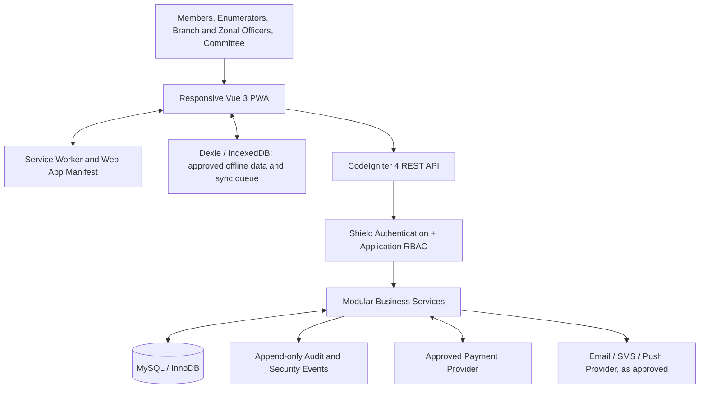
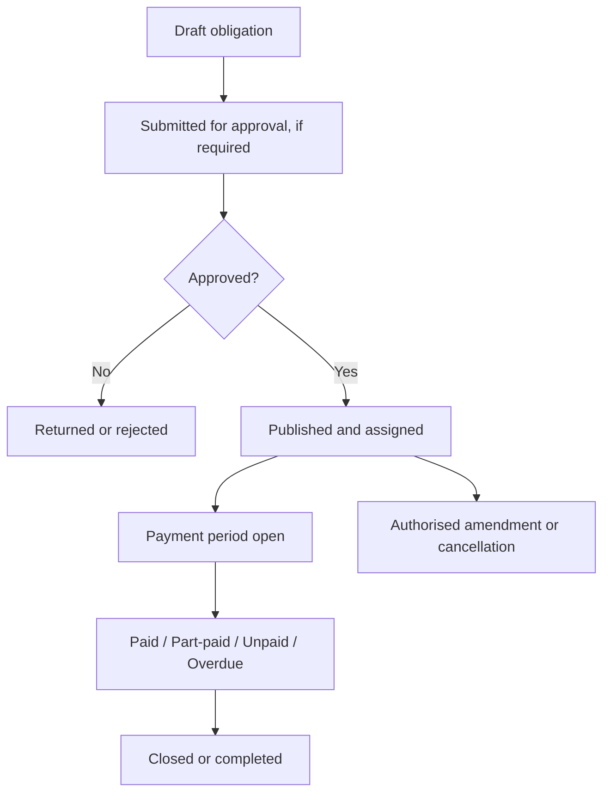

# IEDPU NORTH ZONE DIGITAL MEMBERSHIP, ADMINISTRATION AND DEVELOPMENT PORTAL
# TECHNICAL BLUEPRINT AND SOFTWARE REQUIREMENTS SPECIFICATION (SRS)

**Document ID:** IEDPU-NZ-TECH-SRS-001  
**Version:** 1.0  
**Status:** Draft for technical review and implementation planning  
**Prepared:** 19 November 2026  
**Project:** IEDPU North Zone Digital Membership, Administration and Development Portal  
**Proposed domain:** `iedpu.ng`  
**Geographical scope:** 19 Northern States and the Federal Capital Territory (FCT), Nigeria  
**Initial eligible population:** Existing IEDPU members only  
**Primary project authority:** IEDPU North Zone Initiative Committee, within its formally delegated mandate  
**Document type:** Technical architecture and software requirements specification

---

## DOCUMENT PURPOSE AND HOW TO USE THIS DOCUMENT

This document translates the approved non-technical project blueprint and the additional technical decisions into an implementable system specification.

It defines:

- The recommended application architecture and technology stack.
- The user experience and interface standards.
- The system's functional modules and workflows.
- Authentication, roles, permissions and administrative boundaries.
- Membership registration and branch verification.
- Configurable financial obligations, payments and member statements.
- Announcements and targeted communication.
- Digital membership identification.
- The digital Constitution and document repository.
- Auditability, security, privacy and accountability.
- Progressive Web App (PWA) behaviour and offline synchronisation.
- Hosting, deployment, maintenance and operational requirements.
- Testing requirements and release acceptance criteria.

The next project document will address the **database schema design and strategic phase implementation plan**. This SRS identifies the information and relationships the system must support, but does not attempt to replace the detailed entity-relationship model, table definitions, indexes, migrations or phase-by-phase delivery schedule.

### Requirement language

The words **MUST**, **MUST NOT**, **SHOULD**, **SHOULD NOT** and **MAY** are used deliberately:

- **MUST / MUST NOT:** mandatory requirement.
- **SHOULD / SHOULD NOT:** strong recommendation; deviations require a documented reason.
- **MAY:** optional capability.

A requirement is not considered implemented merely because a screen exists. It must work through the interface, backend rules, database operations, permissions and audit controls.

---

# 1. PROJECT BASELINE AND APPROVED DECISIONS

## 1.1 Project purpose

The first release is a digital membership census and management platform for **existing IEDPU North Zone members**. It is not initially a public census of every Ilorin Emirate descendant.

The platform will establish a reliable digital membership register and provide the foundation for member accounts, branch administration, dues, financial statements, digital identification, official communication and future organisational services.

## 1.2 Approved scope

| Area | System decision |
|---|---|
| Initial eligible population | Existing IEDPU members only |
| Geography | 19 Northern States and FCT |
| Registration model | Individual member registration |
| Membership verification | Primarily by the member's branch |
| Highest project-level portal administration | Initiative Committee |
| Branch administration | Branch Chairmen and authorised Branch Executives |
| Field registration | Authorised enumerators |
| Developer access | Separate technical administration interface |
| Official IEDPU offices | Separate from portal roles |
| Portal actions | Predefined permission catalogue, expandable through controlled releases |
| Dues | Configurable obligations; no fixed dues amounts hardcoded into the application |
| Member financial history | Complete chronological statement |
| Announcements | Target everyone, branches, individuals, selected groups, official offices or portal roles |
| Branch dues automation | Branch request, review, approval and activation workflow |
| Member ID | Professional, unique and verifiable digital ID |
| Constitution | Readable web pages, not PDF-only |
| Application delivery | Installable PWA |
| Offline support | Limited, explicit and safe |
| Domain | `iedpu.ng`, subject to successful registration |
| Initial hosting | Suitable shared hosting, subject to capability and security checks |
| Maintenance | Separately agreed between the Committee and developers |
| Future expansion | Additional branch/zonal administration and wider non-member population census |

## 1.3 Governance boundary

The Initiative Committee is the highest **operational administrator for this project**, subject to the authority delegated by the appropriate IEDPU constitutional structures.

The portal MUST NOT create a new constitutional organ, change the Constitution, redefine membership eligibility or confer constitutional office on a user.

Official IEDPU positions and portal permissions MUST be stored and managed separately.

The Constitution supplied for the project identifies membership and identity-card provisions, organisational organs, branch structures and financial responsibilities. The current authoritative constitutional version and any necessary NEC authorisations must be confirmed before production functions that depend on them are activated.

---

# 2. TECHNICAL ARCHITECTURE

## 2.1 Approved technology stack

The implementation MUST use the following stack unless a documented technical incompatibility is identified and approved before development.

| Layer | Technology | Implementation decision |
|---|---|---|
| Backend language | PHP | PHP 8.5 preferred where supported by the selected host; PHP 8.4 is an acceptable fallback |
| Backend framework | CodeIgniter 4 | Latest stable CodeIgniter 4 release at implementation; v4.7.6 is the current release identified on 19 November 2026 |
| Authentication foundation | CodeIgniter Shield | Use Shield for authentication, sessions and baseline authorization integration |
| Architecture | Modular Monolith | One deployable application with clearly separated business modules |
| Application style | API-centred SPA/PWA | Vue application communicates with CI4 through JSON APIs |
| Frontend framework | Vue 3 | Production global build, compatible with the no-build-tool decision |
| Vue programming approach | Composition API | `setup()` and reusable composables |
| Frontend language | Modern JavaScript ES6+ | No TypeScript |
| JavaScript build tool | None | No Vite, Webpack, Rollup, Babel or Node-based production build |
| Vue Router | None | Small first-party History API navigation controller; no Vue Router dependency |
| Pinia | None | Vue Composition API and composables for application state |
| HTTP client | Native Fetch API | Centralised API helper built on `fetch()` |
| Styling | Bootstrap CSS | Bootstrap 5.3.9, with a controlled IEDPU theme |
| Server database | MySQL-compatible relational database | MySQL 8.x/8.4 preferred; use InnoDB and `utf8mb4` |
| Local development database | MySQL-compatible database through XAMPP | Confirm the actual MySQL/MariaDB version bundled with the installed XAMPP release |
| Offline database | IndexedDB | Browser-side structured storage |
| IndexedDB interface | Dexie.js | Pinned, locally hosted production release |
| PWA | Web App Manifest + Service Worker | Installable application with controlled offline caching |
| API | REST-style JSON over HTTPS | Versioned API, initially `/api/v1/` |
| Web server | Apache-compatible shared hosting | Document root must expose only the public directory |
| Source control | Git | Private repository controlled by the project |
| Dependency management | Composer | Dependencies installed and locked during development/deployment preparation |

### Version policy

The versions above are a project baseline, not permission to install unpinned or untested packages.

At the start of implementation, the developer MUST:

1. Confirm the current stable CodeIgniter 4 release.
2. Confirm compatibility between that release, PHP and CodeIgniter Shield.
3. Install dependencies through Composer.
4. Commit the Composer lock file.
5. Record exact Vue, Bootstrap and Dexie versions.
6. Keep production JavaScript and CSS dependencies locally hosted.
7. Test upgrades before applying them to production.

CodeIgniter 4.7.6 was identified as the current release on the preparation date. Its documentation requires PHP 8.2 or newer and identifies PHP 8.5 compatibility from CodeIgniter 4.7.0 onward. The preferred production target is therefore PHP 8.5 where the shared host supports it and all dependencies pass testing; PHP 8.4 is the fallback. Do not deploy on an end-of-life PHP branch.

## 2.2 Architecture style: Modular Monolith

The portal MUST be implemented as a **modular monolith**, not as a collection of independently deployed microservices.

A modular monolith means:

- One CodeIgniter application.
- One primary relational database.
- One deployment package.
- Clearly separated functional modules.
- Defined boundaries between modules.
- Shared authentication, permissions, audit and validation services.
- Controlled communication between modules through application services.

This is appropriate for the current project because it reduces deployment complexity, hosting cost and maintenance burden while preserving the ability to expand.

Modules MUST NOT directly manipulate another module's data in an uncontrolled manner. Cross-module operations should use defined application services and database transactions where required.

## 2.3 High-level system architecture



## 2.4 Same-origin application

The public website, PWA, member interface, administrative interfaces and API SHOULD operate under the same registered domain and HTTPS origin.

Recommended public address:

- `https://iedpu.ng/` — public information website.
- `https://iedpu.ng/app` — authenticated application entry.
- `https://iedpu.ng/api/v1/` — versioned API.
- `https://iedpu.ng/constitution/` — readable Constitution.

A same-origin approach simplifies cookie-based authentication, CSRF protection, service-worker scope and deployment. CORS SHOULD remain disabled unless a documented future integration requires it.

## 2.5 Frontend implementation without a JavaScript build tool

The no-build-tool requirement is retained.

The frontend MUST use the production global build of Vue 3, served locally by the application. Vue's official documentation confirms that the CDN/global approach requires no build step, but does not support Single-File Component (`.vue`) syntax. Therefore:

- Do not use `.vue` Single-File Components.
- Do not introduce Vite or another bundler.
- Organise JavaScript into readable, separate files.
- Use native browser JavaScript modules where appropriate.
- Use Vue's global API through `window.Vue`.
- Build screens from normal HTML templates and Vue components registered at runtime.
- Use `setup()` and composables for reusable state and logic.
- Keep the production global build, not the development build.

The application MAY use a small, first-party navigation controller based on the browser History API. This is not Vue Router. It must support direct links, browser Back/Forward, refresh and route-level permission checks. Backend authorization remains the actual security boundary.

### Suggested frontend organisation

```text
public/
  assets/
    css/
      bootstrap.min.css
      app-theme.css
      app.css
    js/
      vendor/
        vue.global.prod.js
        dexie.min.js
        bootstrap.bundle.min.js
      core/
        app.js
        api.js
        navigation.js
        auth.js
        permissions.js
        notifications.js
        offline-status.js
      composables/
        useAuth.js
        useMember.js
        useNetwork.js
        useSync.js
        usePermissions.js
      modules/
        dashboard/
        membership/
        verification/
        branches/
        finance/
        announcements/
        constitution/
        audit/
      service-worker.js
    icons/
    images/
  manifest.webmanifest
```

The actual directory names may be refined during development, but module separation and local dependency hosting are mandatory.

## 2.6 Backend module boundaries

The CodeIgniter application SHOULD contain the following business modules:

1. Authentication and account management.
2. Organisation and geographical directory.
3. Official IEDPU office records.
4. Portal role and permission administration.
5. Membership registration and profiles.
6. Branch verification.
7. Enumerator and field operations.
8. Membership ID and QR verification.
9. Financial obligations and dues.
10. Payment processing and reconciliation.
11. Member financial statements.
12. Announcements and recipient targeting.
13. Constitution and document publishing.
14. Audit and security event management.
15. Reports and dashboards.
16. PWA synchronisation support.
17. Support, correction and administrative requests.
18. System configuration and maintenance.

Every module MUST have its own validation, authorization and business rules. The frontend MUST NOT be treated as the source of truth for permissions or financial decisions.

---

# 3. USER EXPERIENCE AND INTERFACE REQUIREMENTS

## 3.1 Golden UI rule

The governing user-interface principle is:

> **Anything a PC user can do or see, a mobile user must also be able to do or see with the same level of simplicity and comfort—preferably better.**

Mobile is not a reduced version of the portal. It is a first-class experience.

The portal must be understandable to a person with limited formal education or technical experience. Technical knowledge must never be a prerequisite for completing ordinary member or administrative tasks.

The interface should make it obvious:

1. Where the user is.
2. What information is being shown.
3. What the user can do.
4. What action should happen next.
5. Whether the action succeeded, failed or is waiting.

## 3.2 Mobile-first and responsive design

The design process MUST begin with small-screen layouts and progressively enhance them for tablets and desktop computers.

The application MUST support:

- Small Android smartphones.
- Larger Android smartphones.
- iPhones and iPads.
- Tablets.
- Laptop screens.
- Desktop monitors.

No essential function may be desktop-only.

A desktop table may become a readable card list on mobile, but the information and actions must remain available.

The application MUST NOT require horizontal scrolling for ordinary forms, dashboards or core member tasks.

## 3.3 Navigation

Navigation should be minimal, predictable and consistent.

Recommended member navigation:

- Home
- My Profile
- My Dues
- Announcements
- More

The **More** area may contain membership ID, Constitution, support and settings.

Recommended administrative navigation should adapt to the user's permissions. It should not display menu items the user cannot access.

On mobile, use a compact bottom navigation for the most common destinations and a clearly labelled menu for secondary functions. On desktop, use a compact sidebar or top navigation.

The same features must remain available on both layouts.

## 3.4 Plain-language interface

The interface MUST use ordinary, clear language.

Prefer:

- “Save changes” instead of “Commit update”.
- “Check membership” instead of “Execute verification”.
- “Money received” or “Payment confirmed” instead of unexplained technical status codes.
- “Waiting for internet” instead of “Offline queue pending”.
- “You do not have permission to do this” instead of an internal authorization error.

Technical terms may appear in administrator documentation, but not unnecessarily in ordinary member workflows.

## 3.5 Screen and interaction standards

The following standards are mandatory design targets:

| Element | Requirement |
|---|---|
| Main text | Normally 16 CSS pixels or larger |
| Primary buttons | Large, clearly labelled and easy to tap |
| Touch controls | Aim for 44 × 44 CSS pixels or larger; never ignore WCAG 2.2 target-size requirements |
| Forms | Single-column on phones |
| Labels | Visible labels, not placeholder-only labels |
| Errors | Explain what is wrong and how to correct it |
| Success | Show a clear confirmation |
| Loading | Show a visible loading state |
| Empty pages | Explain why there is no data and what to do next |
| Destructive actions | Require confirmation and explain consequences |
| Tables | Responsive cards or controlled horizontal scrolling only where unavoidable |
| Icons | Never rely on an icon alone for an important action |
| Focus | Visible keyboard focus |
| Motion | Respect reduced-motion preferences |
| Zoom | Do not disable browser zoom |
| Colour | Never use colour as the only indicator of status |

The WCAG 2.2 AA contrast target is at least 4.5:1 for normal text and 3:1 for large text. WCAG 2.2 also defines a 24 × 24 CSS pixel minimum target-size criterion subject to its stated exceptions. The project SHOULD aim higher for comfortable touch use.

## 3.6 Guided workflows

Complex tasks should be broken into short, guided steps.

For example, member registration should show:

1. Personal details.
2. Contact details.
3. Ancestral and branch information.
4. Review.
5. Submit.

The user should be able to see progress and return to previous steps without losing entered information.

Administrative tasks should use clear summaries before final submission.

## 3.7 Feedback and system status

The interface MUST communicate the state of every important action.

Examples:

- Saved successfully.
- Waiting for internet.
- Changes saved on this device only.
- Synchronising.
- Synced successfully.
- Needs your attention.
- Payment is being confirmed.
- Payment confirmed.
- Verification pending.
- Verification completed.

A button must not silently do nothing.

## 3.8 Performance and low-bandwidth experience

The portal should be designed for variable network quality.

Requirements:

- Minimise unnecessary images and animations.
- Compress uploaded photographs.
- Lazy-load non-essential content.
- Paginate large member lists.
- Avoid loading the entire member directory at once.
- Use compact JSON responses.
- Avoid repeated API calls for unchanged information.
- Provide useful loading and retry states.
- Keep the initial application shell small enough for practical mobile use.

---

# 4. BRAND AND VISUAL DESIGN SYSTEM

## 4.1 Recommended three-colour identity

Retain red as the principal IEDPU brand colour.

The recommended palette is:

| Role | Colour | Hex | Main use |
|---|---|---|---|
| Primary | Deep IEDPU Red | `#B4232F` | Main actions, active navigation, brand emphasis |
| Secondary | Executive Navy | `#17324D` | Headings, navigation structure, dark surfaces |
| Accent | Professional Teal | `#0F766E` | Supporting highlights, selected information and secondary emphasis |

All three selected colours provide at least 4.5:1 contrast against white in the calculated combinations. Final component combinations must still be tested individually.

## 4.2 Colour application rules

- Red should be visible and recognisable, but not cover every screen.
- Navy should provide visual stability and hierarchy.
- Teal should be used sparingly to distinguish supporting information.
- White and very light neutral backgrounds should carry most content.
- Use a consistent neutral grey scale for borders, secondary text and disabled states.
- Use separate semantic status treatments for success, warning, danger and information.
- Do not use the brand accent as a substitute for meaningful status labels.
- Avoid red-on-green or other combinations that rely on colour perception alone.

The selection is based on the requested IEDPU red identity, visual distinction and measurable contrast—not on an unsupported claim that a colour produces a universal psychological response.

## 4.3 Theme tokens

The developer should define central CSS variables for the palette, typography, spacing, radii, shadows, focus rings and status colours. Components should consume those tokens rather than introduce unrelated colours.

Bootstrap CSS variables may be overridden through a small, documented IEDPU theme file. A CSS build step is not required for this approach.

---

# 5. PROGRESSIVE WEB APP AND OFFLINE REQUIREMENTS

## 5.1 PWA objective

The portal MUST be an installable Progressive Web App.

Members should be able to install it from a supported browser and open it from their device's home screen or application launcher in a standalone app-like window.

The PWA must remain the same application and use the same backend as the browser version. It is not a separate native mobile application.

## 5.2 PWA components

The implementation MUST include:

- Web App Manifest.
- Service Worker.
- Application icons, including 192 × 192 and 512 × 512 sizes.
- Standalone display configuration.
- HTTPS in production.
- Versioned static asset caching.
- Offline fallback experience.
- IndexedDB local data store.
- Dexie.js data-access layer.
- Visible synchronisation status.

PWA installation behaviour varies by browser and operating system. The application should provide a clear installation guide where a browser does not expose a standard in-app installation prompt.

## 5.3 Offline capability matrix

Offline capability must be deliberate. The application must not attempt to perform every operation without internet access.

| Function | Offline behaviour |
|---|---|
| Open application shell | Available |
| Open previously cached public Constitution pages | Available |
| View basic member profile | Available if the member opted in on that trusted device and a recent copy exists |
| View last-synced membership summary | Available with a “last updated” label |
| View basic cached member ID image | May be available as an offline copy; it is not live verification |
| Edit approved low-risk profile fields | May be saved locally and queued for synchronisation |
| Draft non-sensitive form content | May be saved locally if explicitly supported |
| Register a new member | Online only in the initial release |
| Verify a member | Online only |
| Approve or reject a membership record | Online only |
| Create or change a financial obligation | Online only |
| Initiate or confirm a payment | Online only |
| Issue, revoke or validate a live ID | Online only |
| Change a branch payment account | Online only |
| Assign roles or permissions | Online only |
| Publish or send announcements | Online only |
| Export sensitive member or financial data | Online only |
| Change passwords or recovery details | Online only |
| Perform other privileged administrative actions | Online only |

## 5.4 Offline profile viewing

A member may opt to keep a limited profile snapshot on a personally trusted device.

The cached snapshot should contain only the minimum information needed for convenient profile viewing, such as:

- Member name.
- Membership number.
- Current branch.
- Last-synced membership status.
- Profile image thumbnail, if approved.
- Last successful synchronisation date.

Do not cache full financial statements, bank details, authentication secrets, full contact records or unrestricted member data.

The interface must clearly say that offline information may be out of date and is not a live confirmation of current membership standing.

Offline profile availability should be opt-in. It should be discouraged on shared or public computers.

## 5.5 Offline profile editing and synchronisation

The requested behaviour is:

1. The member edits an approved profile field.
2. The application attempts to save the change through the online API.
3. If the save succeeds, the server confirms the change.
4. If the request fails because of a genuine network problem, the application offers or performs a clearly indicated local save.
5. The change is stored in IndexedDB through Dexie.js.
6. A pending synchronisation item is created.
7. The interface says that the change is saved on this device but has not yet reached IEDPU's server.
8. When connectivity returns, the application attempts synchronisation.
9. The server validates the user's current session, permission, field rules and record version.
10. The server accepts, rejects or identifies a conflict.
11. The local queue is updated only after a definitive server response.

**A locally saved change is not an approved or official change until the server accepts it.**

## 5.6 Fields eligible for offline editing

Only an explicit allowlist of low-risk profile fields may be queued offline.

The initial allowlist should be approved during implementation. It may include optional professional or profile information that does not affect identity, authentication, eligibility, branch affiliation, financial standing or official records.

The following MUST remain online-only:

- Legal or verified name changes.
- Date of birth changes.
- Telephone or email changes used for authentication or recovery.
- Branch transfer.
- Membership verification status.
- Official IEDPU office.
- Portal roles and permissions.
- Financial information.
- Payment records.
- Membership ID status.
- Any field that changes eligibility or organisational authority.

The server must enforce the same allowlist. A malicious client must not be able to queue a prohibited change by bypassing the interface.

## 5.7 Synchronisation triggers

The application should attempt to synchronise eligible pending changes:

- When the application starts and the network is available.
- When the browser reports a transition back online.
- When the application returns to the foreground.
- When the member selects “Sync now”.
- Through Background Sync where the browser supports it.

Background Sync MUST be treated as an enhancement, not a requirement. It is not supported consistently across major browsers. The application must have a reliable foreground synchronisation fallback.

## 5.8 Synchronisation safety

Each queued operation must have:

- A unique client-generated mutation reference.
- The member and record reference.
- The permitted field changes.
- The local creation time.
- The server record version observed when editing began.
- A retry count and last attempt status.

The server must use idempotent processing so that the same queued operation cannot apply twice when a network retry occurs.

If the server record changed after the local copy was downloaded, the application must not silently overwrite the newer server information.

It should show a conflict and request an appropriate review.

## 5.9 Synchronisation status

The user should see simple status messages:

| Status | Meaning |
|---|---|
| Saved on this device | Stored locally; not yet confirmed by the server |
| Waiting for internet | Network unavailable |
| Synchronising | Sending the queued change |
| Synced | Server accepted the change |
| Needs attention | Server rejected the change or found a conflict |
| Sign in again | Session expired before synchronisation |

A pending item must never be displayed as fully saved or approved.

## 5.10 Local data protection

IndexedDB is browser storage, not a secure vault.

The implementation MUST:

- Keep offline data to the minimum necessary.
- Make offline profile storage opt-in.
- Provide a way to remove the device's offline data.
- Clear cached personal data when the member explicitly removes the device or signs out and chooses to clear it.
- Warn about unsynchronised changes before clearing data.
- Avoid storing passwords, access tokens, payment secrets or bank account details.
- Apply a defined local retention period.
- Consider encryption of eligible local records using Web Crypto after a documented key-management review.
- Explain that local encryption does not protect against a compromised device or malicious same-origin script.

If the user signs out while changes remain queued, the application must clearly explain the consequence and offer a safe choice to synchronise first or discard the pending changes.

## 5.11 Service Worker caching rules

The Service Worker should cache:

- Versioned application shell files.
- Locally hosted CSS and JavaScript libraries.
- Approved public images and icons.
- Public Constitution pages and other approved public documents.
- A simple offline fallback page.

It MUST NOT indiscriminately cache authenticated API responses.

Authenticated personal data should be stored only through the deliberately controlled offline profile feature, not through a broad “cache every request” rule.

The Service Worker must not cache:

- Login or logout responses.
- Payment initiation or payment confirmation responses.
- Financial statements.
- Private member directories.
- Administrative reports.
- Verification queues.
- Role or permission data.
- Sensitive account settings.
- Any response containing secrets or unnecessary personal information.

Service-worker cache versions must be managed so that obsolete application files are removed safely after an update.

## 5.12 PWA update behaviour

When a new application version is available:

- The application should notify the user in plain language.
- The update should not silently interrupt an unfinished payment or administrative action.
- Pending offline changes must be preserved across normal application updates.
- Database upgrades in IndexedDB must be versioned and tested.
- If an update cannot be safely applied, the application should explain the issue and provide a controlled recovery path.

---

# 6. AUTHENTICATION, IDENTITY AND ACCESS CONTROL

## 6.1 Authentication foundation

CodeIgniter Shield MUST be used as the authentication foundation.

For the same-origin Vue PWA and CodeIgniter API, use secure server-managed sessions as the default authentication approach.

Session cookies must be:

- HTTPS-only (`Secure`).
- Unavailable to JavaScript (`HttpOnly`).
- Configured with an appropriate `SameSite` policy.
- Rotated after authentication and privilege changes.
- Expired according to a documented session policy.

Do not store session identifiers, access tokens or authentication secrets in localStorage or ordinary JavaScript-readable storage.

CSRF protection must be applied to state-changing requests that use cookie-based authentication.

## 6.2 Authentication requirements

The system must support:

- Member login.
- Administrator login.
- Secure logout.
- Password reset.
- Account recovery.
- Account activation or invitation.
- Session expiry.
- Failed-login throttling.
- Account suspension.
- Password change.
- Session revocation.
- Multi-factor authentication for privileged accounts.

MFA SHOULD be mandatory for Initiative Committee Super Administrators, finance administrators, role administrators and technical administrators.

## 6.3 Account and member record separation

A member record and a login account are separate concepts.

An enumerator may create a member record before that member creates a login account.

A verified member must be able to claim or link the existing record through a controlled identity-check process.

The system must prevent:

- Multiple login accounts claiming the same member record.
- A user claiming another person's membership record.
- A member changing their membership number.
- A member bypassing branch verification by creating a second account.

## 6.4 Official IEDPU offices versus portal roles

The system must maintain two independent concepts.

### Official IEDPU office

Examples:

- Zonal Chairman.
- Zonal Secretary.
- Branch Chairman.
- Branch Secretary.
- Branch Financial Secretary.
- Branch Treasurer.
- Other recognised offices.

These records describe the person's official organisational position and term or effective period.

### Portal role

Examples:

- Committee Super Administrator.
- Committee Administrator.
- Membership Verification Officer.
- Branch Registration Administrator.
- Financial Records Officer.
- Announcement Administrator.
- Branch Reporting Officer.
- Enumerator.
- Member.

These records describe what the person can do inside the software.

A person may have an official office without any portal administrative role. A person may also have a portal role without holding the corresponding official IEDPU office.

The system must never infer one from the other.

## 6.5 Permission catalogue

Every action available in the application must be represented by a predefined permission.

Examples:

- `members.view`
- `members.register`
- `members.edit`
- `members.verify`
- `members.reject`
- `members.transfer`
- `branches.view`
- `branches.manage`
- `roles.assign`
- `dues.create`
- `dues.approve`
- `dues.publish`
- `payments.view`
- `payments.reconcile`
- `payments.refund`
- `announcements.create`
- `announcements.publish`
- `audit.view`
- `audit.export`
- `constitution.publish`

The list above is illustrative, not the final permission catalogue.

The permission catalogue is controlled by the application and is expandable through documented software releases.

The Committee may assign approved role profiles to stakeholders and may configure role bundles from the available permission catalogue where authorised.

The Committee must not be able to invent arbitrary backend actions or grant permissions that are protected from its administrative level.

## 6.6 Dynamic role assignment and scope

Role assignments must support:

- One or more roles per person.
- Zone scope.
- Branch scope.
- Specific resource scope where required.
- Effective start date.
- Expiry date where applicable.
- Active, suspended and revoked states.
- Assignment reason.
- Assigning administrator.
- Approval reference for high-risk assignments.

Example: a person may be assigned the role of Membership Verification Officer for Abuja Branch only. The same person must not automatically gain access to members of every other branch.

## 6.7 Role administration safeguards

- Users MUST NOT grant themselves higher privileges.
- A developer MUST NOT independently grant themselves Committee authority.
- A Committee administrator MUST NOT silently elevate their own role.
- Granting the highest administrative role SHOULD require a second authorised approval.
- Role changes MUST be audited.
- Removing a role must revoke its effective access.
- Expired assignments must cease to grant access.
- Backend permission checks must run on every protected request.
- Hiding a menu item is not an authorization control.

## 6.8 Developer administration

The developer interface is a separate technical administration area.

It may support:

- Initial stakeholder account provisioning.
- Technical configuration.
- Role and permission catalogue maintenance through controlled releases.
- Deployment and version information.
- System health information.
- Backup and maintenance status.
- Technical error monitoring.
- Approved support operations.

The developer must not automatically have unrestricted access to member financial records, verification decisions or Committee functions.

Where the developer provisions an operational stakeholder account or role assignment, the action must be supported by a Committee-authorised instruction or approval and recorded in the audit trail.

The production environment, domain, hosting and primary data remain under IEDPU-controlled ownership.

---

# 7. FUNCTIONAL SOFTWARE REQUIREMENTS

The requirements below use identifiers so that developers and testers can refer to specific obligations.

## 7.1 Public website and application entry

| ID | Requirement |
|---|---|
| PUB-001 | The system MUST provide a public IEDPU North Zone information website. |
| PUB-002 | The public website MUST explain the purpose of the membership initiative. |
| PUB-003 | The public website MUST provide clear links to member login and registration. |
| PUB-004 | The public website MUST provide access to the readable Constitution. |
| PUB-005 | Public pages MUST be mobile responsive and readable without login. |
| PUB-006 | Private member information MUST NOT be exposed through public pages. |
| PUB-007 | The site MUST use the official approved IEDPU identity and domain. |

## 7.2 Member registration

| ID | Requirement |
|---|---|
| REG-001 | The system MUST register existing IEDPU members only during the initial phase. |
| REG-002 | Each registration MUST be associated with one approved branch. |
| REG-003 | Each member MUST receive a unique system-generated membership reference. |
| REG-004 | The system MUST validate required fields on the server. |
| REG-005 | The system MUST detect and flag possible duplicate registrations. |
| REG-006 | The system MUST record whether a registration was self-submitted or assisted. |
| REG-007 | Assisted registrations MUST identify the enumerator or authorised user responsible. |
| REG-008 | The system MUST distinguish submitted, pending, verified, disputed and rejected records. |
| REG-009 | Registration MUST NOT automatically confer verified membership. |
| REG-010 | Registration and login account creation MUST be separable. |
| REG-011 | Members MUST be able to receive a clear submission reference. |
| REG-012 | Every material registration action MUST be audited. |

## 7.3 Membership verification

| ID | Requirement |
|---|---|
| VER-001 | New registrations MUST enter the correct branch verification queue. |
| VER-002 | Only authorised branch users may make branch-level verification decisions. |
| VER-003 | The Branch Chairman MUST retain final branch-level verification responsibility, subject to delegated permissions. |
| VER-004 | An authorised Branch Executive MAY perform preliminary review. |
| VER-005 | A reviewer MUST be able to approve, request correction, flag or reject with a reason. |
| VER-006 | Unresolved cases MUST be capable of escalation to the Initiative Committee. |
| VER-007 | Verification decisions MUST record reviewer, time, outcome and reason. |
| VER-008 | A verified record MUST not be silently changed back to an unverified state. |
| VER-009 | Financial standing MUST be separate from verification status. |
| VER-010 | Verification MUST be online-only. |

## 7.4 Member accounts and profiles

| ID | Requirement |
|---|---|
| MEM-001 | Verified members MUST be able to access an individual account. |
| MEM-002 | The member dashboard MUST show a clear membership summary. |
| MEM-003 | Members MUST be able to view their profile and branch information. |
| MEM-004 | Members MAY edit fields approved for self-service editing. |
| MEM-005 | Protected identity and branch fields MUST follow an approval workflow. |
| MEM-006 | The system MUST retain a history of material profile changes. |
| MEM-007 | Members MUST be able to request corrections. |
| MEM-008 | Members MUST be able to recover their account securely. |
| MEM-009 | Members MUST be able to view a clear account and synchronisation status. |
| MEM-010 | Offline profile access MUST follow the restrictions in Section 5. |

## 7.5 Branch and geographical administration

| ID | Requirement |
|---|---|
| BRN-001 | The system MUST maintain the approved North Zone branch directory. |
| BRN-002 | Each branch MUST have a unique internal identifier. |
| BRN-003 | Each branch MUST be linked to its approved geographical location. |
| BRN-004 | The Committee MUST be able to create, update, activate or deactivate branch records within its authority. |
| BRN-005 | Branch officers MUST be assignable independently of portal roles. |
| BRN-006 | Branch access MUST be limited to the user's assigned scope. |
| BRN-007 | Branch transfers MUST preserve membership and financial history. |
| BRN-008 | Changes to branch identity or status MUST be audited. |
| BRN-009 | The system MUST distinguish a geographical area from an officially recognised IEDPU branch. |

## 7.6 Enumerator management

| ID | Requirement |
|---|---|
| ENUM-001 | Authorised administrators MUST be able to create or invite enumerator accounts. |
| ENUM-002 | Enumerators MUST be assigned to an approved branch or permitted area. |
| ENUM-003 | Enumerators MUST only access the registration functions and records permitted by their role. |
| ENUM-004 | The system MUST identify the enumerator responsible for an assisted registration. |
| ENUM-005 | Enumerators MUST NOT approve their own registrations unless a separately approved exceptional permission exists. |
| ENUM-006 | Enumerator access MUST be suspendable and revocable. |
| ENUM-007 | Enumerator activity MUST be auditable. |

## 7.7 Portal role and permission administration

| ID | Requirement |
|---|---|
| RBAC-001 | Official IEDPU offices MUST be stored separately from portal roles. |
| RBAC-002 | All executable system actions MUST map to predefined permissions. |
| RBAC-003 | The permission catalogue MUST be expandable through controlled releases. |
| RBAC-004 | The Committee MUST be able to assign authorised portal roles to individuals. |
| RBAC-005 | Role assignments MUST support branch or zone scope. |
| RBAC-006 | Users MAY hold multiple portal roles where approved. |
| RBAC-007 | Role assignments MUST support effective and expiry dates. |
| RBAC-008 | Role changes MUST be audited. |
| RBAC-009 | The backend MUST enforce permissions independently of the frontend. |
| RBAC-010 | No user may elevate their own privilege. |
| RBAC-011 | High-privilege assignments SHOULD require a second approval. |
| RBAC-012 | The developer interface MUST remain separate from operational Committee authority. |

## 7.8 Financial obligations and dues

| ID | Requirement |
|---|---|
| DUE-001 | Dues and financial obligation types MUST be configurable. |
| DUE-002 | Amounts MUST NOT be hardcoded into application logic. |
| DUE-003 | An authorised Super Administrator MUST be able to create a new obligation. |
| DUE-004 | Each obligation MUST include a title, reason, amount and deadline. |
| DUE-005 | An obligation MUST be targetable to all eligible members, an individual, a branch, selected branches or a defined group. |
| DUE-006 | Obligations MUST support one-time and recurring arrangements. |
| DUE-007 | The system MUST record the authority and creator of each obligation. |
| DUE-008 | The system MUST support draft, submitted, approved, active, closed and cancelled states. |
| DUE-009 | Published obligations MUST preserve the terms that applied when they were assigned. |
| DUE-010 | Changes after assignment MUST be recorded as authorised amendments, not silent overwrites. |
| DUE-011 | The system MUST calculate paid, unpaid, partially paid and overdue balances. |
| DUE-012 | Approved waivers, extensions and adjustments MUST be traceable. |
| DUE-013 | Financial obligations MUST be online-only. |
| DUE-014 | Creation, amendment, approval and cancellation MUST be audited. |

## 7.9 Branch dues automation requests

| ID | Requirement |
|---|---|
| BDU-001 | An authorised Branch Chairman or delegated officer MUST be able to request automation of a branch due. |
| BDU-002 | The request MUST capture the reason, amount, target members, frequency and deadline. |
| BDU-003 | The request MUST capture proposed receiving account details. |
| BDU-004 | The request MUST enter an approval workflow. |
| BDU-005 | A request MUST NOT become payable until approved and activated. |
| BDU-006 | The Committee MUST be able to approve, reject or return a request for correction. |
| BDU-007 | Bank details MUST be verified before activation. |
| BDU-008 | Changes to approved bank details MUST require additional verification and approval. |
| BDU-009 | The system MUST preserve previous account details and change history. |
| BDU-010 | Members MUST be shown the approved payment destination and obligation reason. |

## 7.10 Payments and reconciliation

| ID | Requirement |
|---|---|
| PAY-001 | The portal MUST integrate with an approved payment provider. |
| PAY-002 | The payment provider MUST confirm transactions through a verified server-to-server notification or equivalent secure confirmation mechanism. |
| PAY-003 | A browser success message alone MUST NOT mark a payment as paid. |
| PAY-004 | Payment processing MUST be idempotent. |
| PAY-005 | Each payment MUST have a unique transaction reference. |
| PAY-006 | The system MUST support successful, pending, failed, reversed and refunded states. |
| PAY-007 | The system MUST support reconciliation against provider and bank settlement information. |
| PAY-008 | Manual payment records MUST require a specific permission, reference and supporting evidence where appropriate. |
| PAY-009 | The system MUST NOT store raw payment-card details. |
| PAY-010 | Payment, refund, reversal and reconciliation actions MUST be audited. |
| PAY-011 | Payments MUST be online-only. |
| PAY-012 | A failed or abandoned payment MUST NOT be represented as a successful contribution. |

## 7.11 Member financial statement

| ID | Requirement |
|---|---|
| STM-001 | Each member MUST have a chronological financial statement. |
| STM-002 | The statement MUST show all recorded obligations and payments relevant to the member. |
| STM-003 | Each transaction MUST show date, reference, description, amount, status and destination or allocation. |
| STM-004 | The statement MUST distinguish charges, payments, refunds, reversals, waivers and adjustments. |
| STM-005 | Members MUST be able to view outstanding balances. |
| STM-006 | Members MUST be able to download or print their statements. |
| STM-007 | Members MUST be able to retrieve individual receipts. |
| STM-008 | Completed financial transactions MUST NOT be silently deleted or overwritten. |
| STM-009 | Corrections MUST be represented through authorised adjustment or reversal entries. |
| STM-010 | Statement access and exports MUST be appropriately controlled and audited. |

## 7.12 Announcements and targeted communication

| ID | Requirement |
|---|---|
| ANN-001 | Authorised administrators MUST be able to create announcements. |
| ANN-002 | Announcements MUST be targetable to all members, verified members, a branch, selected branches, an individual or a defined group. |
| ANN-003 | Targeting MUST support official IEDPU office and portal role as separate criteria. |
| ANN-004 | The system MUST support targeting all Branch Financial Secretaries or other defined office/role groups. |
| ANN-005 | The publisher MUST be able to preview the intended recipient count and selection before publication. |
| ANN-006 | The system MUST preserve a recipient snapshot at publication time. |
| ANN-007 | Announcements MUST support draft, scheduled, published, cancelled and archived states. |
| ANN-008 | The system MUST record author, approver where applicable, publication time and target definition. |
| ANN-009 | Delivery and read status MAY be tracked where the channel supports it. |
| ANN-010 | Announcement publication and bulk targeting MUST be audited. |

## 7.13 Digital membership ID

| ID | Requirement |
|---|---|
| ID-001 | Each eligible member MUST have a unique membership number. |
| ID-002 | The number MUST remain stable when a member transfers branches. |
| ID-003 | The digital card MUST use the approved IEDPU identity. |
| ID-004 | The card MUST display only approved membership information. |
| ID-005 | The card MUST include a QR verification reference. |
| ID-006 | Public QR verification MUST reveal minimal information. |
| ID-007 | Card issuance, replacement, suspension and revocation MUST be audited. |
| ID-008 | Official issuance MUST be enabled only after appropriate IEDPU authorisation. |
| ID-009 | An offline card copy MUST be clearly marked as not live-verified. |

## 7.14 Constitution and document repository

| ID | Requirement |
|---|---|
| DOC-001 | The Constitution MUST be available as readable web content. |
| DOC-002 | It MUST be divided into manageable pages or sections. |
| DOC-003 | It MUST include a table of contents and previous/next navigation. |
| DOC-004 | The digital text MUST preserve the authoritative wording. |
| DOC-005 | The original PDF MAY be available as a supporting download. |
| DOC-006 | Each published version MUST have a version identifier and effective/publication date. |
| DOC-007 | Only authorised publishers may publish constitutional changes. |
| DOC-008 | Previous versions MUST remain available to authorised reviewers. |
| DOC-009 | Public Constitution pages SHOULD be cached for offline reading. |
| DOC-010 | The portal MUST distinguish approved constitutional text from explanatory material. |

## 7.15 Audit and accountability

| ID | Requirement |
|---|---|
| AUD-001 | Important business and administrative actions MUST create server-side audit events. |
| AUD-002 | Audit events MUST identify who, what, when, where, outcome and affected record. |
| AUD-003 | Sensitive changes MUST record relevant before-and-after values, suitably masked. |
| AUD-004 | Financial and security events MUST be separately classifiable. |
| AUD-005 | Audit records MUST not be editable or deletable through ordinary administrative screens. |
| AUD-006 | Access to audit records MUST itself be audited. |
| AUD-007 | Audit export MUST require a dedicated permission. |
| AUD-008 | High-risk actions MUST support reason capture and additional approval. |
| AUD-009 | Audit events MUST be retained according to an approved retention policy. |
| AUD-010 | The system MUST detect and report audit-writing failures. |
| AUD-011 | Audit records MUST be protected against tampering and unauthorised deletion. |
| AUD-012 | The developer MUST NOT have a hidden mechanism for silently changing production audit records. |

## 7.16 Dashboards and reports

| ID | Requirement |
|---|---|
| RPT-001 | The Committee dashboard MUST show total registrations, verified members and pending verification. |
| RPT-002 | Reports MUST be filterable by branch and approved geographical scope. |
| RPT-003 | Reports MUST distinguish branch-reported baseline figures from verified digital records. |
| RPT-004 | The system MUST show registration coverage against the submitted branch baseline. |
| RPT-005 | The system MUST show verification completion and data completeness. |
| RPT-006 | Financial reports MUST distinguish assessed, collected, outstanding, pending and settled amounts. |
| RPT-007 | Branch users MUST only see reports within their permitted scope. |
| RPT-008 | Sensitive reports and exports MUST be permission-controlled and audited. |
| RPT-009 | Reports MUST show their data period and last update time. |
| RPT-010 | Aggregate reports SHOULD avoid exposing individual personal data unless necessary and authorised. |

---

# 8. AUDIT, SECURITY AND HIGH-RISK ACTION CONTROL

## 8.1 Three distinct record systems

The application should distinguish three related but different records:

1. **Business audit trail:** who performed an organisational action and what changed.
2. **Security event log:** authentication failures, suspicious activity, access denials, session events and security alerts.
3. **Financial ledger/transaction history:** obligations, payments, allocations, refunds, reversals and adjustments.

They serve different purposes and should not be collapsed into one generic text log.

## 8.2 Audit event contents

An audit event should normally contain:

- Unique event reference.
- Server timestamp in UTC.
- Actor user reference.
- Actor role and scope at the time.
- Action/permission key.
- Target record type and reference.
- Event category and severity.
- Before/after values for relevant changed fields.
- Reason or justification.
- Result: success, failure, rejected or deferred.
- Request/correlation reference.
- Session reference in a safely pseudonymised form.
- IP address and user-agent details where lawful and useful.
- Approval reference, where applicable.

Do not store passwords, access tokens, session secrets, full bank credentials or payment-card details in audit logs. Mask or omit unnecessary personal information.

## 8.3 Audit coverage

Audit at minimum:

- Login, logout, failed login and account recovery.
- User creation, suspension and deletion/deactivation.
- Role and permission assignments.
- Member registration and profile changes.
- Verification and rejection decisions.
- Branch creation and changes.
- Dues creation, assignment, amendment and cancellation.
- Payment initiation, confirmation, failure, refund and reversal.
- Bank account submission and changes.
- Announcement creation, targeting and publication.
- Constitution publication and version changes.
- Data exports and bulk downloads.
- Audit-log viewing and export.
- System configuration and deployment changes.
- Backup, restoration and privileged maintenance operations.

Where sensitive information is viewed without being changed, the system SHOULD record that access if the information or report is classified as high-risk.

## 8.4 Tamper resistance

The application should implement:

- Separate audit-writing service.
- Append-only application behaviour.
- Database privileges that prevent ordinary application roles from updating/deleting audit rows.
- Restricted audit access.
- Hash chaining or equivalent tamper-evidence for event sequences.
- Regular protected backups.
- Periodic export of signed audit digests or protected audit copies to a separate IEDPU-controlled location.
- Alerts when audit recording fails or unexpected gaps are detected.

A hash chain alone is not a complete guarantee if an attacker controls the database and all copies. Independent protected copies and separation of duties are required.

Shared hosting has limitations in providing truly immutable storage. If the selected host cannot meet the required audit protection and backup controls, the Committee must approve a stronger hosting arrangement before sensitive production use.

## 8.5 Maker-checker controls

The system SHOULD use a maker-checker process for high-risk activities.

The person initiating an action must not be the only person approving it where a second approval is required.

Examples:

- Granting a Super Administrator role.
- Activating or changing a branch bank account.
- Approving a high-risk financial adjustment.
- Publishing a high-impact general levy.
- Reversing a settled payment.
- Restoring a production backup.
- Changing critical security settings.

The precise approval matrix must be approved by the Committee.

## 8.6 Audit dashboard

Authorised auditors and Committee officers should be able to filter by:

- Date range.
- Actor.
- Branch.
- Action category.
- Affected record.
- Result.
- Risk/severity.
- Approval status.

Audit reports must be exportable only to users with a dedicated export permission.

Every audit search and export should itself create an audit event.

---

# 9. FINANCIAL CONTROL DESIGN

## 9.1 Financial obligation lifecycle

Recommended lifecycle:



## 9.2 Recipient assignment

When an obligation is published, the system must record the actual recipients or the recipient assignment snapshot.

If a member later transfers branches or changes a role, the system must not silently change the original obligation's historical target.

The system must be able to explain why a particular member was assessed for a particular obligation.

## 9.3 Payment verification

A payment must be considered confirmed only after the backend verifies the provider's response or an authorised reconciliation process confirms a manual payment.

The payment workflow must be safe against:

- Repeated callback delivery.
- Duplicate payment references.
- User refreshing the payment page.
- Browser closure during payment.
- Delayed provider confirmation.
- Payment reversal.
- Incorrect amount.
- Payment against an expired obligation.
- Payment to an unapproved destination.

## 9.4 Member statement integrity

The member statement must be built from recorded financial events and allocations, not from a manually editable balance field.

The displayed balance should be derived from the financial history.

A completed transaction is not deleted to correct a mistake. A reversal or adjustment is added with a reference to the original transaction.

## 9.5 Payment provider boundary

The payment provider is responsible for securely collecting payment details.

IEDPU's portal should store only the references and transaction information required for reconciliation and member statements.

The portal MUST NOT store raw card numbers, CVV values or payment-provider secrets in browser storage, audit logs or ordinary application records.

---

# 10. ANNOUNCEMENT AND RECIPIENT TARGETING DESIGN

## 10.1 Recipient selection model

The announcement composer should allow an authorised publisher to select one or more recipient filters:

- All eligible members.
- Verified members only.
- One branch.
- Multiple selected branches.
- One individual.
- A selected list of individuals.
- Official IEDPU office.
- Portal role.
- A permitted combination of these filters.

Official office and portal role must be labelled separately in the interface.

For example:

- “Official office: Branch Financial Secretary”
- “Portal role: Financial Records Officer”

This prevents confusion between an organisational title and a software permission.

## 10.2 Recipient preview

Before publishing, the system must show:

- Selected targeting rules.
- Estimated recipient count.
- Selected branches or groups.
- Any excluded or inactive accounts.
- Delivery channel, if applicable.

For large or sensitive announcements, an authorised approver may be required.

## 10.3 Recipient snapshot

At publication, the system should preserve the recipient list or an equivalent reproducible snapshot.

This ensures that the organisation can later establish who was intended to receive the announcement, even if role or branch assignments change afterwards.

---

# 11. API DESIGN REQUIREMENTS

## 11.1 API principles

The API must:

- Use HTTPS.
- Use JSON for request and response bodies.
- Be versioned, initially under `/api/v1/`.
- Validate every request on the server.
- Enforce authorization on every protected endpoint.
- Return predictable status codes.
- Use server-side pagination for lists.
- Avoid exposing internal database IDs where public opaque references are more appropriate.
- Record correlation/request IDs.
- Apply rate limits to authentication, sensitive and high-volume endpoints.
- Use idempotency for payment and retryable operations.
- Avoid trusting client-supplied roles, prices, balances or approval statuses.

## 11.2 Example endpoint groups

These are conceptual endpoint groups. The final route inventory will be completed during implementation.

| Module | Example route group |
|---|---|
| Authentication | `/api/v1/auth/*` |
| Current user | `/api/v1/me/*` |
| Members | `/api/v1/members/*` |
| Verification | `/api/v1/verifications/*` |
| Branches | `/api/v1/branches/*` |
| Stakeholders | `/api/v1/stakeholders/*` |
| Roles and permissions | `/api/v1/roles/*`, `/api/v1/permissions/*` |
| Dues | `/api/v1/dues/*` |
| Payments | `/api/v1/payments/*` |
| Statements | `/api/v1/statements/*` |
| Branch due requests | `/api/v1/branch-due-requests/*` |
| Announcements | `/api/v1/announcements/*` |
| Membership ID | `/api/v1/membership-cards/*` |
| Constitution | `/api/v1/constitution/*` |
| Audit | `/api/v1/audit/*` |
| Reports | `/api/v1/reports/*` |
| Synchronisation | `/api/v1/sync/*` |

## 11.3 Response format

Responses should follow a consistent structure.

Successful response example:

```json
{
  "success": true,
  "message": "Profile updated successfully.",
  "data": {},
  "meta": {
    "request_id": "opaque-request-reference"
  }
}
```

Validation error example:

```json
{
  "success": false,
  "message": "Please correct the highlighted information.",
  "errors": {
    "phone": ["The phone number is invalid."]
  },
  "meta": {
    "request_id": "opaque-request-reference"
  }
}
```

The actual payloads must not expose stack traces, SQL errors, secrets or internal server details.

## 11.4 HTTP status behaviour

Use appropriate status codes, including:

- `200` — successful read or update.
- `201` — resource created.
- `202` — accepted for asynchronous or deferred processing.
- `204` — successful operation with no response body.
- `400` — malformed request.
- `401` — authentication required or expired.
- `403` — authenticated but not authorised.
- `404` — resource not found or not visible to the user.
- `409` — version conflict or duplicate/state conflict.
- `422` — validation or business-rule failure.
- `429` — rate limit exceeded.
- `500` — unexpected server error.

## 11.5 API transaction safety

Operations that affect multiple related records must use database transactions.

Examples:

- Publishing an obligation and assigning recipients.
- Confirming a payment and allocating it to an obligation.
- Transferring a member between branches.
- Approving a bank account and activating a branch collection destination.
- Assigning a role and recording its audit event.

If an operation fails partway through, the system must not leave inconsistent financial or membership records.

---

# 12. DATABASE AND DATA-INTEGRITY PRINCIPLES

The detailed schema is intentionally reserved for the next document.

The technical implementation must nevertheless observe these principles:

1. Use a relational database with foreign-key constraints where appropriate.
2. Use InnoDB tables.
3. Use `utf8mb4` character encoding and a suitable collation.
4. Use UTC for stored timestamps and display local Nigerian time to users.
5. Use exact decimal types for money; never floating-point arithmetic for financial amounts.
6. Use unique constraints for membership numbers, payment references and other unique identifiers.
7. Use database transactions for related financial and administrative operations.
8. Preserve historical records through status changes and append-only financial events.
9. Use soft deactivation where historical relationships must remain available.
10. Use optimistic concurrency/version fields for offline-edit conflict detection.
11. Use opaque public references where exposing sequential internal identifiers is undesirable.
12. Record the source and actor for imported or assisted data.
13. Use database migrations for controlled schema changes.
14. Keep development, staging and production databases separate.
15. Never use real member information in development unless specifically authorised and appropriately protected.

## 12.1 Data classification

The system should classify information at least as:

- Public.
- Internal.
- Confidential member information.
- Restricted financial/security information.

Access, exports, caching and retention should reflect the classification.

---

# 13. SECURITY AND PRIVACY REQUIREMENTS

## 13.1 Application security

The developer must implement:

- Server-side input validation.
- Output escaping to prevent cross-site scripting.
- CSRF protection.
- Parameterised database access.
- Secure password handling through Shield.
- Session security.
- Rate limiting.
- File-upload validation.
- Secure HTTP headers.
- Restricted administrative routes.
- Error handling that does not reveal internal details.
- Dependency updates and vulnerability review.
- Protection against brute-force login attempts.
- Appropriate backup and restore controls.

## 13.2 Administrative security

Privileged accounts must use MFA.

Sensitive operations should require recent authentication or step-up verification.

The application should notify or alert appropriate administrators when:

- A new Super Administrator is assigned.
- A sensitive bank account is changed.
- A large data export occurs.
- Repeated failed login attempts occur.
- An unusual privilege change occurs.
- Audit logging fails.
- A backup or restoration operation fails.

## 13.3 File uploads

Uploaded profile photographs and documents must:

- Be limited to approved file types.
- Be size-limited.
- Be validated by actual content, not only filename extension.
- Be renamed by the application.
- Be stored outside executable code directories.
- Be scanned or otherwise checked where hosting capability permits.
- Be served with safe content headers.
- Be accessible only to authorised users where private.

## 13.4 Data protection

The project must operate in accordance with applicable Nigerian data protection requirements, including the Nigeria Data Protection Act 2023 and relevant NDPC guidance.

Before production registration, the responsible IEDPU data controller, lawful processing basis, privacy notice, retention policy, data-subject request process and any required impact assessment must be established.

---

# 14. HOSTING AND DEPLOYMENT

## 14.1 Initial hosting

The initial production environment is expected to use shared hosting.

The selected provider MUST be assessed before purchase or deployment.

Minimum requirements include:

- PHP 8.5 preferred, PHP 8.4 fallback.
- Required PHP extensions.
- MySQL-compatible database with InnoDB.
- HTTPS and SSL/TLS support.
- Apache rewrite support or equivalent routing configuration.
- Ability to point the document root to CodeIgniter's `public/` directory, or a safe two-directory deployment.
- Cron jobs or a suitable scheduled-task facility.
- Secure database backups.
- SFTP or another secure deployment method.
- Adequate disk, database and traffic limits.
- Ability to configure environment variables or protected configuration files.
- Provider support for the required application execution model.

## 14.2 CodeIgniter deployment layout

The application root must not be publicly exposed.

Preferred layout:

```text
/home/account/iedpu-app/
    app/
    system/
    vendor/
    writable/
    env
    spark

/home/account/public_html/
    index.php
    .htaccess
    assets/
    manifest.webmanifest
    service-worker.js
    icons/
```

The public web root should contain only public files and the front controller.

The `.env` file, database credentials, source application, vendor code and writable logs must remain outside public access.

CodeIgniter's official shared-hosting guidance recommends pointing the document root to the `public` directory. Where the host does not allow this, it documents a two-directory arrangement with application files outside `public_html`.

## 14.3 Local development with XAMPP

XAMPP may be used for local development and testing.

The developer must:

- Record the PHP version.
- Record whether the bundled database is MySQL or MariaDB and its exact version.
- Use the same database family and compatible SQL behaviour as production.
- Enable required PHP extensions.
- Use HTTPS locally when testing service workers and PWA behaviour, or use the browser's localhost secure-context allowance.
- Maintain separate development configuration.
- Never expose XAMPP directly as the public production server.

## 14.4 Shared-hosting limitations

The shared-hosting plan must be assessed for:

- Cron frequency.
- PHP execution time.
- Memory limits.
- Upload limits.
- Database connection limits.
- Storage limits.
- Backup retention.
- Outbound email restrictions.
- Payment webhook reachability.
- File permission controls.
- Ability to protect audit copies independently.

The initial architecture should avoid depending on Redis, long-running workers, WebSockets or permanently running processes.

Use database-backed scheduled work and cron where available. If a required security or reliability control cannot be achieved on the chosen shared host, the hosting arrangement must be upgraded before sensitive production operations are launched.

## 14.5 Domain and TLS

The proposed domain is `iedpu.ng`, subject to availability and registration.

The domain and hosting accounts must be registered and controlled on behalf of IEDPU, not solely under the personal account of a developer.

All production traffic must use HTTPS. HTTP should redirect to HTTPS.

The Service Worker must be served from the correct scope and must not be blocked by hosting security rules.

## 14.6 Backups and recovery

The system must have:

- Automated database backups.
- Application file backups.
- Separate protected copies of critical audit information.
- Documented backup frequency.
- Documented retention.
- Periodic restoration tests.
- A recovery procedure.
- Named personnel responsible for monitoring backups.

A backup is not considered reliable until restoration has been tested.

---

# 15. NON-FUNCTIONAL REQUIREMENTS

## 15.1 Availability

The application should be designed for reliable day-to-day access.

The hosting service's actual uptime commitment must be reviewed before purchase. The project should establish a practical target and monitoring process rather than promise availability that the hosting provider cannot support.

## 15.2 Performance

Recommended initial targets under normal hosting conditions:

- Common dashboard views should become usable within approximately 3 seconds on a reasonable mobile connection.
- Simple API reads should normally complete within 1 second under normal load.
- Large lists must be paginated.
- Reports may take longer but should show progress or a clear loading state.
- Images should be compressed and appropriately sized.

These are engineering targets to test, not guaranteed hosting performance.

## 15.3 Scalability

The architecture must support adding branches, members, roles, dues categories, reports and administrative modules without redesigning the entire application.

The system should be able to move from shared hosting to a stronger hosting environment without changing its core business model.

## 15.4 Maintainability

The codebase must:

- Use consistent naming.
- Separate modules.
- Avoid duplicated business logic.
- Include comments for non-obvious rules.
- Include setup and deployment instructions.
- Include automated tests for critical operations.
- Maintain a versioned change history.
- Keep dependencies pinned.
- Avoid abandoned or unnecessary packages.

## 15.5 Accessibility

The interface should target WCAG 2.2 AA practices where applicable.

It should support:

- Keyboard navigation.
- Visible focus.
- Screen-reader labels.
- Sufficient contrast.
- Text resizing.
- Clear error messages.
- Large touch targets.
- Reduced motion.
- Accessible form labels and instructions.

## 15.6 Browser support

The application should be tested on current stable versions of:

- Chrome on Android and desktop.
- Samsung Internet where available.
- Microsoft Edge.
- Firefox.
- Safari on iPhone and iPad.

PWA installation and background-sync capabilities vary. Core online functions must remain usable even where an optional PWA capability is unavailable.

## 15.7 Data integrity

The system must never sacrifice financial or membership integrity for offline convenience.

The server remains the authoritative source for membership status, permissions, official records, financial balances and payment confirmation.

---

# 16. TESTING AND QUALITY ASSURANCE

## 16.1 Testing categories

The development team must perform:

1. Unit testing of business rules.
2. Integration testing of modules.
3. API validation and authorization testing.
4. Role and scope testing.
5. Financial transaction testing.
6. Audit completeness testing.
7. PWA installation testing.
8. Offline and synchronisation testing.
9. Responsive interface testing.
10. Accessibility testing.
11. Security testing.
12. Backup and restoration testing.
13. User acceptance testing with actual branch representatives.

## 16.2 Mandatory role-isolation tests

The test team must verify that:

- An Enumerator cannot approve a membership record outside their permission.
- A Branch Chairman cannot view another branch's restricted records unless separately authorised.
- A member cannot view another member's financial statement.
- A Financial Records Officer cannot grant themselves Committee permissions.
- A developer cannot use the technical interface to approve membership or financial operations without an explicit authorised permission.
- A user whose role has expired immediately loses the relevant access.
- Removing a role invalidates the corresponding access on the next protected request.
- Hiding a menu item does not substitute for backend denial.

## 16.3 Mandatory audit tests

For every high-risk action, verify that:

- A successful action creates an audit record.
- A rejected action creates an appropriate security or audit event.
- The actor is correctly identified.
- The affected record is identified.
- Before/after values are correctly captured where appropriate.
- Secrets and sensitive data are not exposed in the log.
- The audit event cannot be changed through ordinary application access.
- Audit viewing and exporting are themselves recorded.
- Audit failure produces an operational alert.

## 16.4 Mandatory financial tests

Verify that:

- A repeated payment callback does not duplicate a payment.
- A browser success screen without provider confirmation does not create a paid record.
- A partial payment updates the outstanding balance correctly.
- A refund or reversal remains visible in the member statement.
- A member transfer does not erase old financial history.
- A cancelled obligation does not silently erase payments already received.
- An unapproved branch account cannot be used for collection.
- A changed obligation does not rewrite the historical terms of previous assignments.

## 16.5 Mandatory offline tests

Verify that:

- The application shell opens offline after successful installation/cache.
- Approved public Constitution pages remain readable offline.
- A member can view only the permitted cached profile snapshot.
- Offline data displays its last-synced time.
- An approved profile edit is queued only when appropriate.
- A queued edit is not displayed as server-approved.
- Synchronisation resumes when connectivity returns.
- Repeated synchronisation does not duplicate the change.
- A 401 response pauses sync and requests sign-in.
- A 409 conflict is presented for review.
- Prohibited sensitive actions remain unavailable offline.
- Application updates do not erase pending changes.

---

# 17. RELEASE ACCEPTANCE CRITERIA

The first foundational release will be accepted only when the following end-to-end workflow works:

1. A Committee Super Administrator signs in securely.
2. The administrator creates or confirms a branch.
3. The administrator provisions a Branch Chairman account.
4. The administrator assigns a portal role independently of the official IEDPU office.
5. The Branch Chairman creates or invites an Enumerator.
6. The Enumerator registers an existing member.
7. The registration appears in the correct branch queue.
8. An authorised branch officer reviews and verifies the member.
9. The verified member claims or creates a login account securely.
10. The member accesses their own profile.
11. The member can see their membership status and branch.
12. The Committee can see accurate aggregate registration and verification statistics.
13. All sensitive actions are traceable in the audit system.
14. The application works at mobile and desktop sizes without loss of core functionality.
15. The PWA can install and provide the approved offline shell and profile behaviour.
16. A prohibited offline action cannot be queued or executed.

Financial and official ID release acceptance must additionally satisfy the financial and constitutional approval requirements described in this document.

---

# 18. IMPLEMENTATION CONSTRAINTS AND OPEN TECHNICAL DECISIONS

The following matters must be resolved during technical preparation. They do not change the approved project vision.

| Item | Required resolution |
|---|---|
| Shared-hosting provider | Confirm PHP 8.5 or 8.4, MySQL compatibility, cron, SSL and document-root control |
| Database engine | Confirm exact production MySQL/MariaDB version and align local XAMPP testing |
| Payment provider | Select approved provider and confirm webhook, settlement and refund capabilities |
| Email/SMS provider | Select approved service and communication policy |
| Official branch directory | Obtain the authoritative branch list and geographical mapping |
| Stakeholder list | Confirm initial Committee and branch personnel |
| Portal role catalogue | Approve first set of predefined roles and permission keys |
| Official IEDPU office list | Confirm recognised offices and effective terms |
| ID card authority | Confirm the required NEC authorisation or delegation |
| Financial account structure | Confirm central, zonal and branch collection arrangements |
| Offline editable fields | Approve the low-risk profile field allowlist |
| Offline retention | Approve device-cache expiry and removal policy |
| Audit retention | Approve retention period and independent audit-copy location |
| Data protection | Confirm controller, privacy notice, lawful basis and retention rules |
| Maintenance arrangement | Agree maintenance scope, response expectations and charges |
| Backup responsibility | Assign monitoring and restoration responsibilities |

## 18.1 Important shared-hosting decision

Do not purchase a shared-hosting plan based only on storage space or advertised bandwidth.

The provider must be checked against the PHP, database, cron, security, backup and deployment requirements in this document.

If the provider cannot safely support the application, select a more capable plan before live member data is introduced.

## 18.2 Important no-build-tool decision

The no-build-tool requirement is feasible with Vue's global production build, normal JavaScript files and local vendor assets.

However, it means the project will not use Vue Single-File Components, compile-time tree-shaking or TypeScript checking.

The development team must compensate through clear module organisation, linting or static checks that do not require a production bundler, code review and automated browser tests.

Do not quietly introduce a build tool without project approval.

---

# 19. DEFINITION OF THE FIRST TECHNICAL DELIVERABLE

The first technical deliverable should be a working application foundation, not a collection of disconnected screen mock-ups.

It should include:

- A working CodeIgniter 4 application.
- Shield authentication.
- Vue 3 production global build.
- Bootstrap theme.
- Same-origin REST API.
- PWA manifest and Service Worker.
- IndexedDB/Dexie foundation.
- Application role and permission service.
- Organisation and branch foundation.
- Member registration workflow.
- Branch verification workflow.
- Central audit service.
- Responsive member and administrative shells.
- Development, staging and production configuration separation.

The next document will define the detailed database schema and strategic implementation phases. It should be produced from this SRS, not independently of it.

---

# 20. TECHNICAL REFERENCES

The following official or primary references were consulted when preparing the technology recommendations. Versions and hosting capabilities must be rechecked at the time of deployment.

1. **CodeIgniter 4 download and release information**  
   https://codeigniter.com/download

2. **CodeIgniter 4 server requirements**  
   https://codeigniter.com/user_guide/intro/requirements.html

3. **CodeIgniter 4 deployment to shared hosting**  
   https://codeigniter.com/user_guide/installation/deployment.html

4. **CodeIgniter Shield documentation**  
   https://shield.codeigniter.com/

5. **CodeIgniter Shield authorization**  
   https://shield.codeigniter.com/latest/references/authorization/

6. **Vue 3 quick start and CDN/global build**  
   https://vuejs.org/guide/quick-start

7. **Vue production deployment without build tools**  
   https://vuejs.org/guide/best-practices/production-deployment

8. **Bootstrap 5.3.9 official getting started guide**  
   https://getbootstrap.com/docs/5.3/getting-started/introduction/

9. **Bootstrap colour system**  
   https://getbootstrap.com/docs/5.3/customize/color/

10. **Dexie.js documentation**  
    https://dexie.org/docs/Dexie.js

11. **MDN Service Worker API**  
    https://developer.mozilla.org/en-US/docs/Web/API/Service_Worker_API

12. **MDN PWA caching guidance**  
    https://developer.mozilla.org/en-US/docs/Web/Progressive_web_apps/Guides/Caching

13. **MDN Background Synchronization API**  
    https://developer.mozilla.org/en-US/docs/Web/API/Background_Synchronization_API

14. **MDN PWA installation guidance**  
    https://developer.mozilla.org/en-US/docs/Web/Progressive_web_apps/Guides/Making_PWAs_installable

15. **W3C Web Content Accessibility Guidelines (WCAG) 2.2**  
    https://www.w3.org/TR/WCAG22/

16. **W3C contrast minimum guidance**  
    https://www.w3.org/WAI/WCAG22/Understanding/contrast-minimum.html

17. **W3C target-size minimum guidance**  
    https://www.w3.org/WAI/WCAG22/Understanding/target-size-minimum

18. **OWASP Logging Cheat Sheet**  
    https://cheatsheetseries.owasp.org/cheatsheets/Logging_Cheat_Sheet.html

---

# END OF TECHNICAL BLUEPRINT AND SOFTWARE REQUIREMENTS SPECIFICATION

**IEDPU NORTH ZONE DIGITAL MEMBERSHIP, ADMINISTRATION AND DEVELOPMENT PORTAL**

**Document ID:** IEDPU-NZ-TECH-SRS-001  
**Version:** 1.0  
**Prepared:** 19 November 2026
